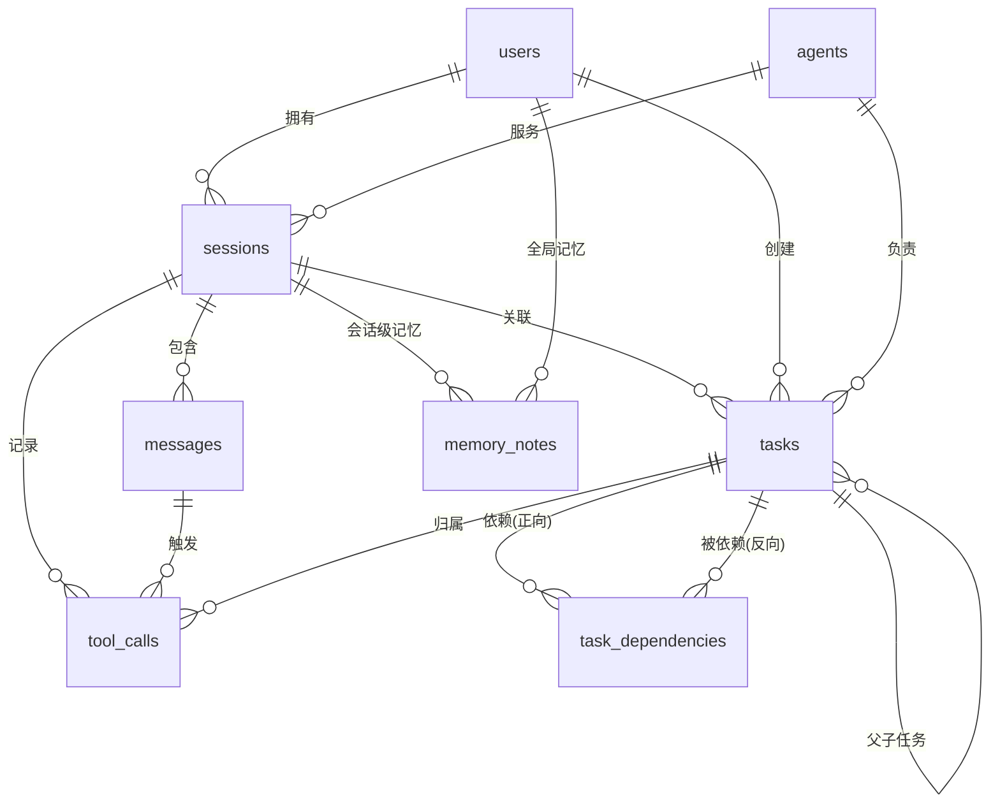

# 演示项目数据库设计

> 状态：设计完成（task_b2cc4bc2）  
> 配套 DDL：[`docs/schema.sql`](schema.sql)（可直接执行，`PRAGMA user_version = 1`）  
> 后续任务：`task_14c0a7c5` 依据本设计实现 API 接口

---

## 1. 设计目标与边界

演示项目需要一个能承载"**用户 → 会话 → 消息 → 工具调用**"以及"**智能体协作任务（含依赖）**"和"**跨会话记忆**"的最小可用数据层。设计遵循以下取舍：

| 决策 | 理由 |
| --- | --- |
| **SQLite（3.35+，实测 3.45.3）** | 零依赖、随项目文件走、单文件便于演示；`requirements.txt` 无需新增包，Python 标准库 `sqlite3` 直接可用 |
| **主键用 TEXT（ULID/UUID）** | 与现有 `.tasks/task_XXXX.json` 的 ID 风格一致，便于与文件型存储互通、可分布式生成 |
| **时间统一 TEXT + UTC ISO-8601**（`2025-01-31T08:00:00.000Z`） | 字符串可直接比较/排序，`ORDER BY` 不需要函数包装；跨语言无时区歧义 |
| **枚举用 TEXT + CHECK** | 可读性好于魔法数字，改动成本低（SQLite 无原生 ENUM） |
| **半结构化数据存 TEXT + `json_valid()`** | 工具参数/结果结构多变，避免过度建模；同时保证写入的确实是合法 JSON |
| **不做软删除、不做多租户** | 演示项目保持简单；删除通过外键级联/置空表达 |

**明确不做**：鉴权会话表、计费、向量检索（memory 只存文本，不做 embedding）。

---

## 2. 实体关系（ER）



文字版关系：

```
users 1───n sessions n───1 agents
sessions 1───n messages 1───n tool_calls n───1 tasks(可为 NULL)
tasks 1───n tasks (parent_task_id 自引用)
tasks n───n tasks (task_dependencies 关联表，DAG)
memory_notes: users(全局) 或 sessions(会话级)
```

---

## 3. 表结构

字段类型约定：`TEXT`(字符串/ID/时间/JSON)、`INTEGER`(计数/布尔/优先级)。所有表默认值中的 `created_at/updated_at` 为 `strftime('%Y-%m-%dT%H:%M:%fZ','now')`（UTC）。

### 3.1 `users` — 用户

| 字段 | 类型 | 约束 | 说明 |
| --- | --- | --- | --- |
| id | TEXT | PK | ULID |
| username | TEXT | NOT NULL, UNIQUE, `length 3..32` | 登录名 |
| display_name | TEXT | NOT NULL | 显示名 |
| email | TEXT | UNIQUE, NULL 允许, `LIKE '%_@_%.__%'` | 简单格式校验 |
| role | TEXT | NOT NULL, DEFAULT 'member', CHECK in (`admin`,`member`,`viewer`) | 权限角色 |
| password_hash | TEXT | NULL | 演示可留空；真实场景存 argon2/bcrypt |
| created_at / updated_at | TEXT | NOT NULL, 默认 now | |

### 3.2 `agents` — 智能体

| 字段 | 类型 | 约束 | 说明 |
| --- | --- | --- | --- |
| id | TEXT | PK | |
| name | TEXT | NOT NULL, UNIQUE, 非空 trim | 如 `lead`、`alpha`、`beta` |
| role | TEXT | NOT NULL, DEFAULT 'teammate', CHECK in (`lead`,`teammate`,`subagent`) | 对应 `agent/teams.py`、`subagents.py` |
| model | TEXT | NOT NULL | 如 `claude-sonnet-4-6` |
| system_prompt | TEXT | NULL | 可覆盖默认提示词 |
| is_active | INTEGER | NOT NULL, DEFAULT 1, CHECK in (0,1) | 停用但不删 |

### 3.3 `sessions` — 会话

| 字段 | 类型 | 约束 | 说明 |
| --- | --- | --- | --- |
| id | TEXT | PK | |
| user_id | TEXT | NOT NULL, FK→users(id) **ON DELETE CASCADE** | 用户删则会话删 |
| agent_id | TEXT | FK→agents(id) **ON DELETE SET NULL** | 智能体停用/删除不销毁历史 |
| title | TEXT | NOT NULL, DEFAULT 'Untitled session' | |
| status | TEXT | NOT NULL, DEFAULT 'active', CHECK in (`active`,`archived`) | |
| message_count | INTEGER | NOT NULL, DEFAULT 0, `>=0` | 冗余计数，写消息时 +1（避免每次 count） |
| token_count | INTEGER | NOT NULL, DEFAULT 0, `>=0` | 上下文窗口用量 |
| context_summary | TEXT | NULL | 上下文压缩后的摘要（对应 `agent/context.py`） |
| created_at / updated_at / last_active_at | TEXT | NOT NULL | `last_active_at` 用于会话列表排序 |

### 3.4 `messages` — 消息

| 字段 | 类型 | 约束 | 说明 |
| --- | --- | --- | --- |
| id | TEXT | PK | |
| session_id | TEXT | NOT NULL, FK→sessions(id) ON DELETE CASCADE | |
| seq | INTEGER | NOT NULL, `>0`, **UNIQUE(session_id, seq)** | 会话内单调递增序号，替代 `ORDER BY 时间` 的抖动问题 |
| role | TEXT | NOT NULL, CHECK in (`system`,`user`,`assistant`,`tool`) | |
| content | TEXT | NOT NULL, DEFAULT '' | 纯文本；多模态块序列化后存放 |
| token_count | INTEGER | NOT NULL, DEFAULT 0, `>=0` | |
| stop_reason | TEXT | NULL | `end_turn` / `tool_use` / `max_tokens` |
| parent_message_id | TEXT | FK→messages(id) ON DELETE SET NULL | 支持分支/重试链 |
| created_at | TEXT | NOT NULL | |

### 3.5 `tasks` — 任务

| 字段 | 类型 | 约束 | 说明 |
| --- | --- | --- | --- |
| id | TEXT | PK | 与 `.tasks/task_*.json` 对齐 |
| session_id | TEXT | FK→sessions(id) ON DELETE SET NULL | |
| parent_task_id | TEXT | FK→tasks(id) ON DELETE CASCADE, `<> id` | 子任务随父任务删除；禁止自引用 |
| subject | TEXT | NOT NULL, trim 非空 | 任务标题 |
| description | TEXT | NOT NULL, DEFAULT '' | |
| status | TEXT | NOT NULL, DEFAULT 'pending', CHECK in (`pending`,`in_progress`,`completed`,`failed`,`cancelled`) | 与现有 `task_store` 状态机一致 |
| priority | INTEGER | NOT NULL, DEFAULT 2, CHECK 1..4 | 1 最高；默认 2 = P2 |
| owner_agent_id | TEXT | FK→agents(id) ON DELETE SET NULL | 认领者 |
| created_by | TEXT | FK→users(id) ON DELETE SET NULL | |
| attempt_count | INTEGER | NOT NULL, DEFAULT 0, `>=0` | 失败重试计数 |
| blocked_reason | TEXT | NULL | 被依赖阻塞时的说明 |
| created_at / updated_at | TEXT | NOT NULL | |
| started_at / completed_at | TEXT | NULL；`completed_at` 非空时 status 必须是 completed/failed/cancelled | 终态一致性 |

### 3.6 `task_dependencies` — 任务依赖（DAG 边）

| 字段 | 类型 | 约束 | 说明 |
| --- | --- | --- | --- |
| task_id | TEXT | NOT NULL, FK→tasks(id) ON DELETE CASCADE | 下游任务 |
| depends_on_task_id | TEXT | NOT NULL, FK→tasks(id) ON DELETE CASCADE | 上游任务 |
| created_at | TEXT | NOT NULL | |
| **PRIMARY KEY (task_id, depends_on_task_id)** | | | 天然去重；同时服务"查某任务的前置依赖" |
| CHECK | | `task_id <> depends_on_task_id` | 禁止自环 |

> 环检测（跨多层的循环依赖）不放进 DDL——SQLite 触发器实现代价高，交由服务层在写入前做 DFS 校验；DDL 只兜住最常见的自环。

### 3.7 `tool_calls` — 工具调用审计

| 字段 | 类型 | 约束 | 说明 |
| --- | --- | --- | --- |
| id | TEXT | PK | |
| session_id | TEXT | NOT NULL, FK→sessions(id) ON DELETE CASCADE | 必填，保证任何工具调用都能追溯到会话 |
| message_id | TEXT | FK→messages(id) ON DELETE CASCADE | 触发它的 assistant 消息 |
| task_id | TEXT | FK→tasks(id) ON DELETE SET NULL | 执行任务时产生则关联 |
| tool_name | TEXT | NOT NULL, 非空 trim | `write_file` / `bash` / ... |
| arguments | TEXT | NOT NULL, DEFAULT '{}', `json_valid()` | 工具入参 JSON |
| result | TEXT | NULL | 工具输出（截断后存放） |
| status | TEXT | NOT NULL, DEFAULT 'pending', CHECK in (`pending`,`succeeded`,`failed`,`denied`) | `denied` 对应权限系统拒批 |
| error_message | TEXT | NULL | 失败原因 |
| duration_ms | INTEGER | NULL, `>=0` | 耗时统计 |
| created_at | TEXT | NOT NULL | |

### 3.8 `memory_notes` — 记忆笔记

| 字段 | 类型 | 约束 | 说明 |
| --- | --- | --- | --- |
| id | TEXT | PK | |
| user_id | TEXT | FK→users(id) ON DELETE CASCADE | 全局记忆归属用户 |
| session_id | TEXT | FK→sessions(id) ON DELETE CASCADE | 为空 = 全局；非空 = 会话级 |
| type | TEXT | NOT NULL, DEFAULT 'project', CHECK in (`user`,`project`,`reference`,`feedback`) | 对应 `.memory/*.md` 的分类 |
| name | TEXT | NOT NULL, 非空 trim | 稳定标识符（kebab-case） |
| description | TEXT | NOT NULL, DEFAULT '' | 一句话摘要，供模型快速浏览 |
| content | TEXT | NOT NULL, 非空 | 正文 |
| pinned | INTEGER | NOT NULL, DEFAULT 0, CHECK in (0,1) | 置顶记忆始终注入上下文 |
| created_at / updated_at | TEXT | NOT NULL | |

---

## 4. 索引设计（为什么建、服务哪条查询）

共 18 个显式索引（含 1 个表达式唯一索引）+ 各表 UNIQUE 约束隐含的唯一索引。

| 表 | 索引 | 字段 | 服务的查询 |
| --- | --- | --- | --- |
| users | `idx_users_role` | (role) | 管理端按角色筛选用户 |
| agents | `idx_agents_active_role` | (is_active, role) | `GET /agents?active=1&role=teammate` |
| sessions | `idx_sessions_user_active` | (user_id, status, last_active_at DESC) | 会话列表：某用户活跃会话按最近活跃排序 |
| sessions | `idx_sessions_agent_status` | (agent_id, status) | 某智能体进行中的会话 |
| messages | `idx_messages_session_created` | (session_id, created_at) | 会话内按时间回放/分页 |
| messages | `idx_messages_role` | (session_id, role) | 取某会话最后一条 user 消息等 |
| tasks | `idx_tasks_status_priority` | (status, priority, created_at) | **待办队列**：`status='pending' ORDER BY priority, created_at`（最热的查询） |
| tasks | `idx_tasks_owner_status` | (owner_agent_id, status) | 某 agent "我的任务" |
| tasks | `idx_tasks_session` | (session_id, created_at DESC) | 会话任务列表 |
| tasks | `idx_tasks_parent` | (parent_task_id) | 展开子任务树 |
| tasks | `idx_tasks_created_by` | (created_by, created_at DESC) | 我创建的任务 |
| task_dependencies | `idx_task_deps_depends_on` | (depends_on_task_id) | "谁依赖我"→ 上游完成后解锁下游（主键已覆盖反方向） |
| tool_calls | `idx_tool_calls_message` | (message_id) | 渲染某条消息的工具调用卡片 |
| tool_calls | `idx_tool_calls_task` | (task_id, created_at) | 任务的执行轨迹 |
| tool_calls | `idx_tool_calls_name_status` | (tool_name, status, created_at DESC) | 工具成功率/耗时报表、排障 |
| memory_notes | `uq_memory_notes_scope` | (IFNULL(user_id,''), IFNULL(session_id,''), type, name) **UNIQUE** | 同一作用域内笔记名唯一（NULL 会绕过普通 UNIQUE，故用表达式） |
| memory_notes | `idx_memory_notes_session` | (session_id, updated_at DESC) | 会话记忆增量注入 |
| memory_notes | `idx_memory_notes_pinned` | (pinned, updated_at DESC) | 置顶记忆优先加载 |

**索引取舍说明**
- 复合索引遵循最左前缀：`idx_tasks_status_priority` 也能服务"只按 status 查"。
- 时间字段在索引中声明 `DESC` 仅为表意；SQLite 从 3.3 版本起支持反向扫描，`DESC` 声明不影响可用性。
- 低基数字段（如 `is_active`、`pinned`）不单独建索引，只作为复合索引前缀。
- 写入放大：`messages` / `tool_calls` 是大表候选，索引仅 2–3 个；若后续按会话物理分表，可先删 `idx_tool_calls_name_status`。

---

## 5. 关键约束与一致性规则

1. **外键默认不生效**：连接后必须执行 `PRAGMA foreign_keys = ON`（`schema.sql` 开头已声明，但每个新连接都要重新设一次）。
2. **建议连接参数**：`PRAGMA journal_mode = WAL; PRAGMA synchronous = NORMAL; PRAGMA busy_timeout = 5000;`（并发读 + 单写场景）。
3. **冗余计数**：`sessions.message_count / token_count` 在插入消息的同一事务内更新，避免 `COUNT(*)` 全表扫描。
4. **终态一致性**：任务只有在 completed/failed/cancelled 时才允许写 `completed_at`。
5. **环检测**：服务层在插入 `task_dependencies` 前做 DFS/BFS，防止 A→B→A 的循环依赖。
6. **状态机**：`tasks.status` 合法迁移
   `pending → in_progress → (completed | failed)`，任意非终态可 `→ cancelled`；终态不可回退（由服务层校验）。
7. **软约束**：`email` 的唯一性对 NULL 允许多行（SQLite 语义），即多个用户可不填邮箱。

---

## 6. 数据访问示例

```sql
-- 6.1 会话列表（带消息数、最后活跃时间）
SELECT s.id, s.title, s.message_count, s.last_active_at
FROM sessions s
WHERE s.user_id = ? AND s.status = 'active'
ORDER BY s.last_active_at DESC
LIMIT 20 OFFSET ?;

-- 6.2 待办任务队列（优先级 + 创建时间）
SELECT t.id, t.subject, t.priority, a.name AS owner
FROM tasks t
LEFT JOIN agents a ON a.id = t.owner_agent_id
WHERE t.status = 'pending'
ORDER BY t.priority, t.created_at
LIMIT 50;

-- 6.3 找出某任务的全部前置依赖（含已完成状态，用于判断能否启动）
SELECT d.depends_on_task_id, up.status, up.subject
FROM task_dependencies d
JOIN tasks up ON up.id = d.depends_on_task_id
WHERE d.task_id = ?;

-- 6.4 上游任务完成后，解锁的下游任务
SELECT t.id, t.subject
FROM task_dependencies d
JOIN tasks t ON t.id = d.task_id
WHERE d.depends_on_task_id = ?
  AND t.status = 'pending'
  AND NOT EXISTS (
      SELECT 1 FROM task_dependencies d2
      JOIN tasks up ON up.id = d2.depends_on_task_id
      WHERE d2.task_id = t.id AND up.status NOT IN ('completed', 'cancelled')
  );

-- 6.5 一次对话的完整时间线（消息 + 工具调用）
SELECT m.seq, m.role, m.content, tc.tool_name, tc.status
FROM messages m
LEFT JOIN tool_calls tc ON tc.message_id = m.id
WHERE m.session_id = ?
ORDER BY m.seq, tc.created_at;

-- 6.6 工具健康度（近 7 天）
SELECT tool_name,
       COUNT(*) AS calls,
       SUM(status = 'succeeded') AS ok,
       ROUND(AVG(duration_ms), 1) AS avg_ms
FROM tool_calls
WHERE created_at >= strftime('%Y-%m-%dT%H:%M:%fZ', 'now', '-7 days')
GROUP BY tool_name
ORDER BY calls DESC;
```

写入示例（含事务与计数更新）：

```sql
BEGIN;
INSERT INTO messages (id, session_id, seq, role, content, token_count)
VALUES (?, ?, (SELECT IFNULL(MAX(seq), 0) + 1 FROM messages WHERE session_id = ?), 'assistant', ?, ?);
UPDATE sessions
SET message_count = message_count + 1,
    token_count   = token_count + ?,
    last_active_at = strftime('%Y-%m-%dT%H:%M:%fZ', 'now'),
    updated_at     = strftime('%Y-%m-%dT%H:%M:%fZ', 'now')
WHERE id = ?;
COMMIT;
```

---

## 7. 到 API 的映射（供 task_14c0a7c5 使用）

| 资源 | 接口 | 主要表 | 说明 |
| --- | --- | --- | --- |
| 用户 | `POST /users`、`GET /users/{id}`、`GET /users?role=` | users | 创建/查询 |
| 智能体 | `GET /agents`、`POST /agents`、`PATCH /agents/{id}` | agents | `is_active` 用于上下线 |
| 会话 | `POST /sessions`、`GET /sessions?user_id=&status=`、`PATCH /sessions/{id}` | sessions | 列表走 `idx_sessions_user_active` |
| 消息 | `GET /sessions/{id}/messages?after_seq=`、`POST /sessions/{id}/messages` | messages + sessions | 游标分页用 `seq`；写入需事务 + 计数更新 |
| 任务 | `POST /tasks`、`GET /tasks?status=&owner=`、`PATCH /tasks/{id}`（状态流转） | tasks | 状态迁移需校验状态机 |
| 依赖 | `POST /tasks/{id}/dependencies`、`DELETE /tasks/{id}/dependencies/{dep}`、`GET /tasks/{id}/dependencies` | task_dependencies + tasks | 写入前做环检测 |
| 工具调用 | `GET /sessions/{id}/tool_calls`、`POST /tool_calls` | tool_calls | `arguments` 以 JSON 对象进、字符串存入 |
| 记忆 | `GET /memory_notes?session_id=&type=`、`POST /memory_notes`、`PATCH /memory_notes/{id}` | memory_notes | `session_id` 省略 = 全局记忆 |

**通用约定**：JSON 字段 `arguments` 在 API 层是对象、在库内是字符串，需在 DAO 边界做 `json.dumps/loads`；所有时间对外均返回 ISO-8601 UTC 带 `Z`。

---

## 8. 验证记录（已执行）

用 `python`（SQLite 3.45.3）实际执行 `docs/schema.sql` 并做了正反向验证：

- ✅ 建表：`agents, memory_notes, messages, sessions, task_dependencies, tasks, tool_calls, users` 共 8 张表
- ✅ 显式索引 18 个，`PRAGMA user_version = 1`
- ✅ 完整链路插入成功（user → agent → session → message → task → 子任务 → 依赖 → tool_call → memory_note）
- ✅ 约束按预期拒绝：重复 `(session_id, seq)`、非法 `role`/`status` 枚举、自依赖、悬空外键、非法 JSON、用户名过短/重复、同作用域重名笔记
- ✅ 级联行为正确：删除父任务 → 子任务与依赖行被级联删除，`tool_calls.task_id` 置 NULL
- ✅ `EXPLAIN QUERY PLAN` 确认走索引（无 `SCAN`）：
  - `messages`: `sqlite_autoindex_messages_2 (session_id=?)`
  - `tasks`: `idx_tasks_status_priority (status=? AND priority=?)`
  - `sessions`: `idx_sessions_user_active (user_id=? AND status=?)`
  - `task_dependencies`: `idx_task_deps_depends_on (depends_on_task_id=?)`
  - `tool_calls`: `idx_tool_calls_name_status (tool_name=? AND status=?)`

---

## 9. 后续演进（不在本次范围）

1. **迁移机制**：以 `PRAGMA user_version` 为准，`migrations/001_init.sql`、`002_xxx.sql` 顺序执行。
2. **全文检索**：`memory_notes.content` 可挂 FTS5 虚拟表（`CREATE VIRTUAL TABLE memory_notes_fts USING fts5(content, content='memory_notes', content_rowid='rowid')`）。
3. **分区/归档**：`messages`、`tool_calls` 按会话归档到历史库；`sessions.status='archived'` 已预留语义。
4. **审计与计费**：`tool_calls.token_count`、`cost_micro_usd` 可后加列（SQLite `ALTER TABLE ADD COLUMN` 代价极低）。
