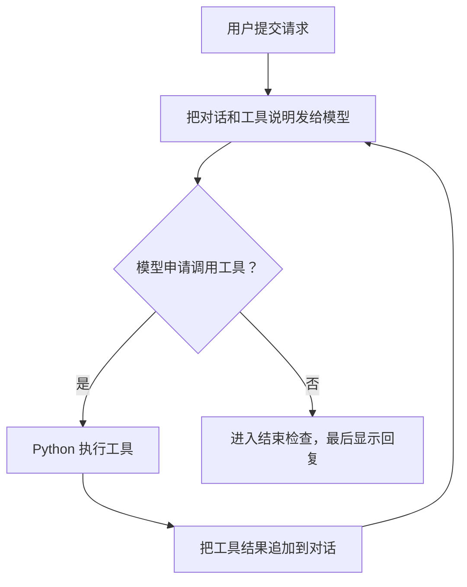

# 第 1 章 · Agent Loop 学习笔记

在终端输入「读这个文件的第一行」，一次请求通常会用到两次模型调用。第一次，模型请 Python 读文件。第二次，模型看到文件内容，再把答案告诉你。把这几个动作接起来的代码就是 Agent Loop。 [原项目第 1 章中文说明](https://github.com/shareAI-lab/learn-claude-code/blob/main/s01_agent_loop/README.zh.md)

## 1. 跟着一条请求走

在项目根目录运行 `python main.py`。终端出现 `agent >>` 后输入下面这句话。

```text
请用 read_file 读取 playground/greeting.txt 的第一行，原样告诉我这行是什么。
```

文件的第一行是 `Hello World`。下面按主模型选择 `read_file` 并成功读取的情况走一遍。 [练习文件](../playground/greeting.txt)



1. **先记下用户的话。** `submit_query()` 把请求追加到 `history`，随后把同一个列表交给 `agent_loop()`。循环里把这个参数叫作 `messages`。 [main.py · submit_query](../main.py#L182) · [agent/loop.py · agent_loop](../agent/loop.py#L30)
2. **第一次问模型。** `request_model()` 接收当前的 `messages` 和工具清单。模型可以返回一个 `tool_use`，相当于说「请叫 `read_file` 读取这个路径」。模型的整条回复以 `role=assistant` 加入列表。 [agent/client.py · request_model](../agent/client.py#L48) · [agent/loop.py · 保存模型回复](../agent/loop.py#L161)
3. **Python 读文件。** 主循环把工具请求交给 `execute_tool()`，拿到文本后做成 `tool_result`。这个小块放在下一条 `role=user` 的消息里，这是程序按接口格式回传结果时用的角色。 [agent/tools/executor.py · execute_tool](../agent/tools/executor.py#L11) · [agent/loop.py · 回传结果](../agent/loop.py#L221)
4. **第二次问模型。** 同一段对话现在既有最初的请求，也有工具返回的 `Hello World`。模型可以据此答复。本次模型响应没有工具调用时，主循环进入结束检查，退出后由 `print_assistant_reply()` 显示回复。 [agent/loop.py · 结束分支](../agent/loop.py#L172) · [main.py · print_assistant_reply](../main.py#L41)

## 2. 为什么结果要带上工具调用 ID

假设你同时让模型读两个文件，它可能一次申请两次 `read_file`。两次工具名相同，内容可能也相同，所以程序用每次申请附带的 ID 把结果配回原处。下面省略了消息外层，`toolu_demo` 只是演示用的 ID。

```json
[
  {
    "type": "tool_use",
    "id": "toolu_demo",
    "name": "read_file",
    "input": {"path": "playground/greeting.txt", "limit": 1}
  },
  {
    "type": "tool_result",
    "tool_use_id": "toolu_demo",
    "content": "Hello World"
  }
]
```

循环每次都把列表重新交给模型。把调用与结果保存在列表里，模型下一次才能把「我刚才要读哪个文件」和「读到了什么」连起来。

## 3. 从哪里开始手敲

按 `submit_query()` → `agent_loop()` → `execute_tool()` 的顺序读。先在纸上写四条消息，依次是用户请求、模型的工具调用、工具结果、模型的最终回复。找到前三条分别在哪里被追加，再找「没有工具调用」的分支。原版 s01 用 `bash` 演示第一种工具。本项目的终端入口包含后续章节，所以这里用已接入的 `read_file` 讲同一个循环。

下一章跟着 `read_file` 的名字，找到真正读取文件的 Python 函数。 [第 2 章 · Tool Use](s02-tool-use.md)
