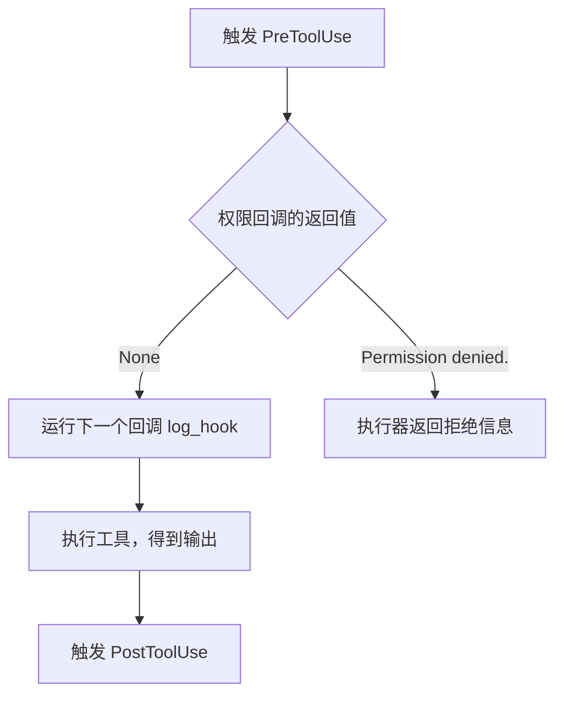

# 第 4 章 · Hooks 学习笔记

Hook 是登记在某个事件上的函数。例如，工具准备执行时，程序触发 `PreToolUse`，权限检查和日志就会按登记顺序运行。主流程在相应位置发出事件，具体要做的检查写在各自的函数里。 [原项目第 4 章中文说明](https://github.com/shareAI-lab/learn-claude-code/blob/main/s04_hooks/README.zh.md)

## 1. 先找登记的地方，再找触发的地方

打开 `agent/hooks.py` 文件底部，能看到程序启动时装好的回调。回调是保存起来、等事件发生时才调用的函数。比如 `register_hook("PreToolUse", permission_hook)` 传进去的是函数本身，真正检查时才由事件调度器把 `block` 传给它。 [agent/hooks.py · 注册入口](../agent/hooks.py#L26) · [agent/hooks.py · 已登记的回调](../agent/hooks.py#L95)

| 事件 | 触发位置 | 当前回调做什么 |
|---|---|---|
| `UserPromptSubmit` | `main.py` 的 `submit_query()` | 打印工作目录。函数名是 `context_inject_hook`，当前实现执行的是日志输出 |
| `PreToolUse` | `execute_tool()` 查执行函数之前 | 先检查权限，再打印工具名和参数预览 |
| `PostToolUse` | `execute_tool()` 得到输出后 | 输出超过十万字符时打印提醒 |
| `Stop` | 主循环准备结束时 | 统计当前消息列表里的 `tool_result` 块 |

触发点分别在 [终端入口](../main.py#L206)、[工具执行器](../agent/tools/executor.py#L11) 和 [主循环](../agent/loop.py#L172)。主循环单独处理 `compact`，它走专门的分支。 [第 8 章 · Context Compact](s08-context-compact.md)

## 2. 一次拒绝为什么没有后置日志



`trigger_hooks()` 遇到第一个非 `None` 返回值便结束本事件，剩下的回调跳过。权限检查通过时返回 `None`，所以日志回调继续执行。拒绝时返回非空字符串，执行器原样返回，后置钩子也就没有触发。如果执行函数抛出异常，执行器会把异常变成 `Error: ...` 并交给后置钩子。 [agent/hooks.py · trigger_hooks](../agent/hooks.py#L35) · [agent/tools/executor.py · 前置与后置钩子](../agent/tools/executor.py#L19)

同一条返回规则可用来影响停止时机。主循环走到「本次模型没有申请工具」的分支时，`Stop` 若返回非空文本，主循环就把它加到对话里再问模型一次。当前登记的 `summary_hook()` 只打印统计，返回 `None`。 [agent/loop.py · Stop 分支](../agent/loop.py#L172) · [agent/hooks.py · summary_hook](../agent/hooks.py#L72)

## 3. 用已有脚本体验

```powershell
python check_hooks.py
```

脚本构造两条假的工具调用，只触发 `PreToolUse`，因此无需请求模型，也不会执行其中的命令。第一条检查工作目录内的读文件请求，能看到工具日志和 `None`。第二条命中拒绝列表，能看到拒绝结果，日志回调被跳过。 [check_hooks.py](../check_hooks.py)

到这里，工具申请、权限与日志都已经能沿一条请求串起来。下一章给多步骤请求加上待办清单。 [第 5 章 · TodoWrite](s05-todo-write.md)
