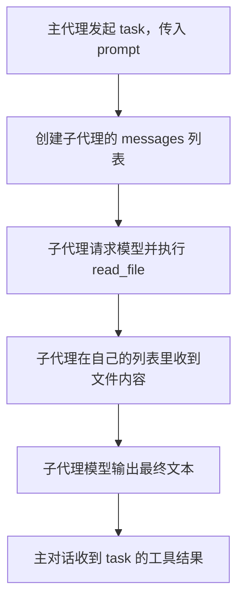

# 第 6 章 · Subagent 学习笔记

主代理说「帮我查这个文件的第一行，只告诉我结论」，子代理就拿着这条要求开一段新对话，自己问模型、读文件，再把结论交回来。主代理下一次看到的是一条工具结果，因此它可以继续处理自己的其他工作。 [原项目第 6 章中文说明](https://github.com/shareAI-lab/learn-claude-code/blob/main/s06_subagent/README.zh.md)

## 1. 主代理和子代理分别看见什么



| 时刻 | 主代理的对话 | 子代理的对话 |
|---|---|---|
| 派活时 | 留下 `task(prompt=...)` 的工具调用 | 刚创建，只放进这条 `prompt` |
| 查文件时 | 等待 `task` 返回 | 记录自己的 `read_file` 调用和结果 |
| 查完时 | 收到 `task` 的结果，例如 `Hello World` | 最终回复被提取成文本，交还给调用者 |

清空历史后，父对话里说过的约定也需要写进 `prompt` 才能随任务传过去。把文件路径和期望的输出都说清楚，子代理收到一条消息就能开始。

## 2. 顺着 `task` 找到实际运行的代码

1. 在注册表中找 `TASK_TOOL` 和 `"task": run_subagent`。模型提供一个 `prompt`，执行器会把它交给 `run_subagent()`。 [agent/tools/registry.py · TASK_TOOL](../agent/tools/registry.py#L51) · [工具函数映射](../agent/tools/registry.py#L131)
2. `run_subagent()` 构造 `[{"role": "user", "content": prompt}]`，再调用 `run_subagent_turn()`。新列表就是主、子两段对话的分界。这个函数调用会等子代理结束后才返回，所以父代理此时在等待。 [agent/subagents.py · run_subagent](../agent/subagents.py#L41)
3. `run_subagent_turn()` 走自己的「问模型 → 执行工具 → 追加结果」循环。默认给它五个基础工具，工具调用仍走共用执行器和权限检查。工具清单里没有 `task`，一次派活就不会继续派出下一层。子代理与主代理使用同一工作区，若调用写文件工具，修改会留在工作区里。 [基础工具清单](../agent/tools/base.py) · [子代理循环](../agent/subagents.py#L54)
4. 子代理模型准备结束且 `Stop` 没要求继续时，`extract_text()` 取最终响应里的文本块。普通 `task` 最多请求模型 30 次，耗尽时会返回停止原因。父循环用父级 `task` 的 ID 将文本包装成工具结果。 [agent/subagents.py · extract_text](../agent/subagents.py#L24) · [父循环回传工具结果](../agent/loop.py#L236)

## 3. 后面几个名字容易记混

| 名字 | 你交给它什么 | 这一步结束时主代理看到什么 |
|---|---|---|
| `task` 子代理 | 一段能独立理解的自然语言任务 | 等查完后收到子代理的最终文本 |
| 后台任务 | 一个允许在后台运行的 Shell 命令 | 先收到任务 ID，结束通知之后再进入对话 |
| Team 队友 | 能持续收信、回复和领任务的成员 | 通过队友消息和共享任务状态协作 |
| 第 10 章的任务条目 | 任务标题、描述、依赖或状态 | 保存任务记录，可列出、领取或标记完成 |

Team 的队友也调用 `run_subagent_turn()` 跑模型和工具，但会传入队友自己的历史、额外工具与分发函数。复用的是「模型与工具如何来回交互」这段代码。 [agent/teams.py · 队友模型回合](../agent/teams.py#L145) · [第 10 章](s10-task-system.md) · [第 11 章](s11-background-tasks.md) · [第 13 章](s13-agent-teams.md)

## 4. 观察一条委派

```text
请用 task 派一个子代理读取 playground/greeting.txt 第一行。让它用 read_file，只返回该行。你拿到结果后告诉我这一行。
```

观察 `[Subagent started]`、子代理的 `[sub] read_file`、`[Subagent done]`。`[sub]` 是给你看的终端日志，主模型收到的是 `task` 的最终文本。

下一章给模型一份可以按需展开的操作说明。 [第 7 章 · Skill Loading](s07-skill-loading.md)
