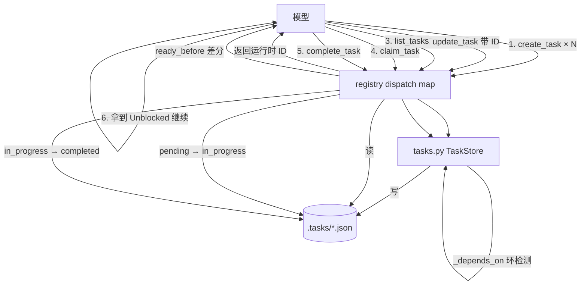

# s10 Task System · 工作流程与原理总结

> 对应章节：[learn-claude-code s10_task_system](https://github.com/shareAI-lab/learn-claude-code/tree/main/s10_task_system)
> 学习进度：**10 / 17 章**
> 整理日期：2026-11-07

| 项 | 内容 |
|---|---|
| 一句话定义 | 把"任务"从**会话内的步骤清单**升级成**落盘、带依赖图、可认领**的任务系统 |
| 课程格言 | *"大目标拆成小任务，排好序，持久化。"* |
| 代码落点 | [agent/tasks.py](../agent/tasks.py)、[agent/tools/registry.py](../agent/tools/registry.py)、[agent/prompts.py](../agent/prompts.py) |
| 数据落点 | `.tasks/task_xxxxxxxx.json` |
| 主循环改动 | **零**（s02 的 dispatch map 红利） |

**一句话总结整章**：

> **任务系统 = 一个 JSON 文件 + 一张依赖图 + 一台三状态机器。**
> 文件让它活过会话，依赖图让它知道先后，状态机让它不被乱改。

---

## 目录

1. [为什么 TodoWrite 不够](#1-为什么-todowrite-不够)
2. [磁盘上长什么样](#2-磁盘上长什么样)
3. [数据结构](#3-数据结构)
4. [全景：三层结构](#4-全景三层结构)
5. [工作流程：两阶段建图](#5-工作流程两阶段建图)
6. [一次任务的完整生命周期](#6-一次任务的完整生命周期)
7. [状态机](#7-状态机)
8. [环检测原理](#8-环检测原理)
9. [解锁差分原理](#9-解锁差分原理)
10. [核心函数速查](#10-核心函数速查)
11. [6 个工具与 schema 约束](#11-6-个工具与-schema-约束)
12. [原则 → 机制 → 代码](#12-原则--机制--代码)
13. [验收清单](#13-验收清单)
14. [常见坑](#14-常见坑)
15. [与前后章节的关系](#15-与前后章节的关系)
16. [下一章](#16-下一章)
17. [附：Mermaid 总览](#附mermaid-总览)

---

## 1. 为什么 TodoWrite 不够

**场景**：让 agent 做"给项目加用户功能"，拆成三件事：

1. 建数据库表
2. 写接口（必须等建表完成）
3. 写测试（必须等接口完成）

第一天做完第 1 步，关电脑。第二天重开：

| | TodoWrite（s05） | Task System（s10） |
|---|---|---|
| 昨天三件事在哪 | 只在内存，**已经没了** | `.tasks/` 三个文件还在 |
| 第二天知道什么 | 什么都不知道，要重说一遍 | 读到：表已完成、接口可开始、测试还堵着 |
| 能判断"现在该干嘛"吗 | 不能（没记谁等谁） | 能（`blockedBy` 记着依赖） |
| 存储 | 进程内存 | `.tasks/{id}.json` |
| 依赖 | 无 | `blockedBy` 依赖图 |
| 分工 | 无 | `owner` / claim |
| 更新契约 | **整表替换** | 单条记录 CRUD |

所以要存的东西只有两样：

- **每个任务本身的资料**（叫什么、做到哪一步）
- **任务之间的"谁等谁"**（依赖关系）

s10 剩下的全部代码，都是在把这两样东西安全地 存 / 取 / 改。

---

## 2. 磁盘上长什么样

```
.tasks/
├─ task_a1b2c3d4.json          ← "setup database schema"
└─ task_5e6f7a8b.json          ← "create API endpoints"
```

`task_a1b2c3d4.json`：

```json
{
  "id": "task_a1b2c3d4",
  "subject": "setup database schema",
  "description": "",
  "status": "pending",
  "owner": null,
  "blockedBy": []
}
```

`task_5e6f7a8b.json`（接口任务，要等表做完）：

```json
{
  "id": "task_5e6f7a8b",
  "subject": "create API endpoints",
  "description": "",
  "status": "pending",
  "owner": null,
  "blockedBy": ["task_a1b2c3d4"]
}
```

**读懂这两段就够了**：第二天的 agent 把文件读出来，发现 endpoints 的 `blockedBy` 指向一个 `pending` 任务 → 现在还不能做。

**为什么一个任务一个文件，而不是一个大 `tasks.json`？**

| 一个文件 | 一个大文件 |
|---|---|
| 单条损坏只丢一条 | 写到一半断电，全部损坏 |
| 多个 agent 可各读各的（s13 需要） | 写冲突，得加锁 |
| 文件即记录，人可直接看 | 必须写工具才能改 |

---

## 3. 数据结构

```python
@dataclass
class Task:
    id: str
    subject: str
    description: str
    status: str          # pending | in_progress | completed
    owner: str | None    # 认领它的 agent 名
    blockedBy: list[str] # 前置任务 ID 列表
```

| 字段 | 含义 | 约束 |
|---|---|---|
| `id` | 任务编号，`task_` + 8 位十六进制 | 运行时随机生成，正则校验 |
| `subject` | 一句话标题 | 不能为空 |
| `description` | 详细说明 | 可空 |
| `status` | `pending` / `in_progress` / `completed` | 只允许这三个值 |
| `owner` | 谁认领的 | 未认领为 `None` |
| `blockedBy` | 前置任务 id 列表 | 空列表 = 随时可做 |

`@dataclass` 的作用：

- 自动生成 `__init__` → 字段名拼错时**构造就报错**（裸 dict 会静默错）
- `asdict()` 一键转普通 dict → 存 JSON 用

> 字段名用驼峰 `blockedBy` 是**刻意的**：工具参数名也叫 `addBlockedBy`，模型看到的和代码里的必须一致。

---

## 4. 全景：三层结构

```
┌─ 模型（LLM）
│   它能看到的只有：6 个工具名 + 描述 + 参数 schema
│   create_task / update_task / list_tasks / get_task
│   claim_task / complete_task
│   ※ 模型无法直接读写 .tasks/ 文件
└──────────────────┬───────────────────────
                   │ 工具调用（名字 + 参数）
                   ▼
┌─ registry.py（dispatch map，s02 机制）
│   TOOLS          = schema 列表（给模型看的说明书）
│   TOOL_HANDLERS  = name → 函数（真正执行）
└──────────────────┬───────────────────────
                   │
                   ▼
┌─ tasks.py
│
│   ① 包装层  run_*：参数名对接、返回值转字符串、终端打印
│      ─────────────────────────────────────────────
│   ② 状态机  can_start / claim_task / complete_task
│      建图    update_dependencies + _depends_on（环检测）
│      ─────────────────────────────────────────────
│   ③ 持久层  TaskStore：_root / _path / create / save
│             load / list_all / exists
└──────────────────┬───────────────────────
                   │ 读写 JSON
                   ▼
       .tasks/task_xxxxxxxx.json
```

**三个关键认知**：

1. **模型看不见文件**，它只能通过工具操作任务——这正是 harness 的意义：**能力边界由工具定义**。
2. **每层职责单一**：持久层只管文件，状态机只管规则，包装层只管格式。
3. **主循环零改动**：新工具进 dispatch map 就能用，`loop.py` 完全不用碰。

---

## 5. 工作流程：两阶段建图

```
模型想建：schema → endpoints → tests

时间轴 ──────────────────────────────────────────────────▶

╔═ 第 1 轮（模型一次回复里发 4 个工具调用）══════════════╗
║ create_task("setup database schema")                   ║
║ create_task("create API endpoints")                    ║
║ create_task("write tests")                             ║
║ create_task("write docs")                              ║
╚═══════════════════════════════════════════════════════╝
        │  这些调用的**参数在结果产生前就确定了**
        │  所以不可能在参数里写另一个 create 返回的 ID
        ▼
   工具结果：task_a1b2c3d4 / task_5e6f7a8b / task_11223344 / task_99aabbcc
        │
╔═ 第 2 轮：用返回的 ID 连边 ════════════════════════════╗
║ update_task(task_5e6f7a8b, addBlockedBy=[task_a1b2c3d4])  ║
║ update_task(task_11223344, addBlockedBy=[task_5e6f7a8b])  ║
║ update_task(task_99aabbcc, addBlockedBy=[task_a1b2c3d4])  ║
╚═══════════════════════════════════════════════════════╝
        │
        ▼
   图建立完成：

      schema ──▶ endpoints ──▶ tests
        │
        └──────▶ docs
```

**为什么必须两阶段**（这是本章最反直觉的地方）：

> ID 是**运行时**生成的，模型无法预知。工具调用是**并行发出**的，彼此拿不到返回值。

所以 system prompt 里必须明说：

> *create_task returns a runtime-generated ID... build the graph in two rounds: create all nodes, then call update_task with the exact returned IDs.*

---

## 6. 一次任务的完整生命周期

```
                      create_task
                           │
                           ▼
                    status = pending
                    owner  = None
                    blockedBy = [...]
                           │
             ┌─────────────┴──────────────┐
             │  can_start?                │
             │  所有 blockedBy 都 completed│
             └─────────────┬──────────────┘
                    ┌──────┴──────┐
                  否 │             │ 是
                    ▼             ▼
               继续阻塞       claim_task(owner)
              (无动作)             │
                                   ▼
                            in_progress
                                   │
                                   ▼
                            complete_task
                            （校验 owner）
                                   │
                                   ▼
                              completed
                                   │
                                   ▼
                        扫描下游 → 算解锁差分
                                   │
                                   ▼
                    返回 "Unblocked: endpoints, docs"
```

---

## 7. 状态机

```
        claim_task                  complete_task
pending ───────────▶ in_progress ───────────────▶ completed
   │                      │
   │                      │ 守卫条件：
   │                      │  · status 必须 in_progress
   │                      │  · owner 必须匹配
   │                      │
   │  守卫条件（claim）：
   │  · status 必须 pending
   │  · 所有 blockedBy 都 completed
   │
   └─ 依赖边（blockedBy）只允许在这里改：
        条件是 pending 且 owner is None
        （任务一旦开始，图冻结）
```

**为什么要"图冻结"**：如果允许任务进行中追加前置依赖，就会出现"干到一半突然被告知前面还有个活没做"——状态不能倒退。**图的修改必须发生在图被消费之前。**

**为什么 `complete_task` 要校验 owner**：防止 A 把 B 认领的任务标记完成。现在只有一个 agent 看不出区别，**s13 多 agent 时这就是"谁的任务谁说了算"的地基**。

---

## 8. 环检测原理

**目标**：加依赖 `T → D` 之前，确认不会形成环。

**思路**：反向问一句——**D 会不会（顺着依赖）走回 T？** 会，则加边成环。

```
函数语义：_depends_on(task_id, target_id)
          = 「task_id 能否顺着 blockedBy 一路走到 target_id」
```

### 例子：检查 `_depends_on(C, A)`，此时 B 等 A、C 等 B

```
        A ◀── B ◀── C         （箭头 = "blockedBy"，即"我要等它"）
```

| 轮次 | `pending`（待检查） | 取出 `current` | 判断 | `visited` | 追加 `blockedBy` |
|---|---|---|---|---|---|
| 开始 | `[C]` | — | — | `{}` | — |
| 1 | `[C]` | C | C ≠ A | `{C}` | B → `pending=[B]` |
| 2 | `[B]` | B | B ≠ A | `{C,B}` | A → `pending=[A]` |
| 3 | `[A]` | A | **A == A ✓** | — | 返回 `True` |

→ 说明 C 间接依赖 A，所以 **不能再加 A→C**，否则三者死锁。

### 反例：`_depends_on(A, C)`

| 轮次 | `pending` | 取出 | 判断 | `visited` | 追加 |
|---|---|---|---|---|---|
| 开始 | `[A]` | — | — | `{}` | — |
| 1 | `[A]` | A | A ≠ C | `{A}` | `blockedBy=[]` |
| 结束 | `[]` | — | 循环结束 | — | 返回 `False` |

### 三个细节

1. **必须"传递"检测**：A 和 C 之间没有直接边，只看直接依赖永远查不出环。
2. **`visited` 防死循环**：如果图已经被手改出环（X→Y→X），没有 `visited` 会永远走不完。
3. **迭代而非递归**：用 `pending` 列表 + `pop()` 是显式栈，任务链再长也不会爆 Python 递归深度。

---

## 9. 解锁差分原理

完成一个任务后，要告诉模型"什么变了"。**不能简单说"现在有哪些能开始的"**——那样会把本来就能开始的也误报成"刚解锁"。

```
完成前                                    完成后
────────                                  ────────
任务图：                                  任务图：
  A  [in_progress]  → 先完成              A  [completed]
  B  等 A      （不可开始）                B  等 A      （现在可以开始 ✓）
  C  无依赖    （一直可以开始）            C  无依赖    （还是可以开始）
  D  等 B      （不可开始）                D  等 B      （仍不可开始）

ready_before = {C}          ← 完成前的"可开始"集合（只算有依赖的）
ready_after  = {C, B}       ← 完成后的"可开始"集合
unblocked    = ready_after - ready_before = {B}
```

**返回给模型**：`Completed A ... Unblocked: B` —— 只有 B，不含 C。

如果不做差分，模型会看到"C 刚解锁"，于是又跑去处理一个**本来就能处理**的任务，白绕一圈。

实现要点：

```python
ready_before = {c.id for c in list_tasks()
                if c.status == "pending" and c.blockedBy and can_start(c.id)}
# —— 完成目标 ——
task.status = "completed"
TASKS.save(task)
unblocked = [c.subject for c in list_tasks()
             if c.status == "pending" and c.blockedBy
             and c.id not in ready_before and can_start(c.id)]
```

`and c.blockedBy` 这个条件：**只关心"有依赖的任务"被解锁**。无依赖任务本来就能开始，不该进集合（否则 `ready_before` 里塞一堆无关任务）。

---

## 10. 核心函数速查

### 持久层（`TaskStore`，类内部）

| 函数 | 作用 | 关键点 |
|---|---|---|
| `_root(create)` | 得到任务目录 | 必须在 WORKDIR 内 |
| `_path(task_id)` | ID → 文件路径 | 正则 + 越界双重校验 |
| `exists(id)` | 任务是否存在 | 依赖校验用 |
| `create(subject, desc)` | 新建任务 | `token_hex(4)` 随机 ID + `open("x")` 排他写 |
| `save(task)` | 覆盖写回 | `write_text`（区别于 create） |
| `load(id)` | 读成 Task | 校验文件内 ID / status 合法 |
| `list_all()` | 列出全部 | `glob("task_*.json")` + 排序 |
| `_depends_on(a, b)` | a 是否传递依赖 b | DFS + visited |
| `update_dependencies(id, deps)` | 加依赖 | 冻结检查 + 自依赖 + 存在 + 环检测 |

### 模块级函数

| 函数 | 作用 |
|---|---|
| `create_task` / `update_task` | 薄封装（参数名对齐工具 schema） |
| `load_task` / `list_tasks` / `get_task` | 读；`get_task` 返回 JSON 字符串 |
| `incomplete_dependencies(task)` | 未完成的前置（**文件缺失也算未完成**） |
| `can_start(id)` | 是否可以开始 |
| `claim_task(id, owner)` | `pending → in_progress` |
| `complete_task(id, owner)` | `in_progress → completed` + 解锁差分 |

### handler 包装（`run_*`）

| 函数 | 返回字符串示例 |
|---|---|
| `run_create_task` | `Created task_a1b2c3d4: setup database schema` |
| `run_update_task` | `Updated task_... blockedBy: task_...` |
| `run_list_tasks` | 多行：`[ ] task_...: subject [pending] (blockedBy: ...)` |
| `run_get_task` | 完整 JSON |
| `run_claim_task` | `Claimed task_... (subject)` 或 `Blocked by: [...]` |
| `run_complete_task` | `Completed task_...` + `Unblocked: ...` |

> handler 的硬约束：**参数名与 schema 属性逐字一致；返回值必须是字符串**（模型只读文本）。

---

## 11. 6 个工具与 schema 约束

| 工具 | 必填参数 | schema 里的约束 |
|---|---|---|
| `create_task` | `subject` | `additionalProperties: False` |
| `update_task` | `task_id`, `addBlockedBy` | id 用 `pattern` 限制格式；`minItems: 1` |
| `list_tasks` | 无 | `{"type": "object", "properties": {}}` |
| `get_task` | `task_id` | — |
| `claim_task` | `task_id` | description 提醒"依赖已完成" |
| `complete_task` | `task_id` | description 提醒"本人认领的" |

**schema 的作用**：它是给模型的**约束提示**（生成参数时尽量满足），从源头减少无效调用。
**schema 不是安全边界**：代码里 `TASK_ID_PATTERN` 仍然保留——**schema 减少错误，代码负责兜底**。

> `COMPACT_TOOL` 在 `TOOLS` 里但**不在** `TOOL_HANDLERS`（loop 级工具，需要动 `messages`）。
> 6 个任务工具两边都要有（只动磁盘文件，普通工具即可）。
> 判断标准：**它需要循环本体参与吗？**

---

## 12. 原则 → 机制 → 代码

| 原则 | 机制 | 落点 |
|---|---|---|
| 落盘可恢复 | 一任务一 JSON 文件 | `.tasks/{id}.json` |
| 模型不能编 ID | 运行时随机 + 排他写 | `secrets.token_hex(4)` + `open("x")` |
| 能力边界由工具定义 | schema + handler 注册 | [registry.py](../agent/tools/registry.py) |
| 两阶段建图 | 先 create 拿 ID，再 update 连边 | system prompt 明说 |
| 图冻结 | 非 pending / 有 owner 拒绝改依赖 | `update_dependencies` |
| 环检测 | 传递闭包 DFS | `_depends_on` |
| fail-closed | 依赖文件缺失也算未完成 | `incomplete_dependencies` |
| 状态机守卫 | 每次转移校验状态与 owner | `claim_task` / `complete_task` |
| 通知算差分 | `ready_before` 与完成后集合做差 | `complete_task` |
| 零改主循环 | dispatch map | s02 机制红利 |

---

## 13. 验收清单

**① 两阶段建图**
> `Create tasks: setup database schema, create API endpoints (depends on schema), write tests (depends on endpoints), write docs (depends on schema)`

观察：第一轮**只调 create_task**（4 次），第二轮才 `update_task`。

**② 列图**
> `List all tasks and their statuses`

应看到状态、`blockedBy` 关系、owner 为空。

**③ 认领 + 完成 + 解锁**
> `Claim the first unblocked task and complete it`

关键：返回值含 `Unblocked: ...`，且只含**因这次完成而解锁**的任务。

**④ 拒绝非法认领**
> `Claim the tests task`

应返回 `Blocked by: ['task_...']`。

**⑤ 环检测**
> `Make the schema task depend on the tests task`

应返回 `Error: Dependency cycle detected: ...`。

**⑥ 跨会话恢复**（本章意义所在）
`q` 退出 → 重开 → `Where did we leave off? Check the task list.`

应调 `list_tasks`（必要时 `get_task`）从硬盘恢复进度，而不是失忆。

**离线验收**：`check_tasks.py`（不需要 API）
- 建 3 个任务 + 2 条依赖
- 拒绝成环 / 自依赖 / 不存在的依赖

---

## 14. 常见坑

| # | 坑 | 现象 | 处理 |
|---|---|---|---|
| 1 | 一次回复里同时 create + update | `update_task` 拿到不存在的 ID | prompt 明确"先建全部节点，再连边" |
| 2 | `create` 用 `write_text` 而非 `open("x")` | 撞 ID 时静默覆盖别的任务 | 必须排他创建 |
| 3 | 依赖检查漏掉"文件缺失" | 前置被删后下游意外放行 | `incomplete_dependencies` catch `FileNotFoundError` |
| 4 | 解锁不做差分 | 反复通知"刚解锁"，模型绕圈 | `ready_before` 快照 |
| 5 | 方法名 `list` 遮蔽内置 `list` | 类内类型标注/调用出怪事 | 改名 `list_all` |
| 6 | 变量名与 s06 的 `TASK_TOOL` 撞名 | registry 里覆盖、模型看到错工具 | 用 `CREATE_TASK_TOOL` 等前缀 |
| 7 | 工具名 `task`（子代理）与 `create_task` 混淆 | 模型挑错工具 | 子代理工具改名 `explore` |
| 8 | system prompt 少说"两阶段" | 模型编造 ID | 必须写进 prompt |
| 9 | 没加 `.tasks/` 到 `.gitignore` | 任务状态被提交进仓库 | 忽略运行时状态 |

---

## 15. 与前后章节的关系

```
s05 TodoWrite ──升级──▶ s10 Task System ──地基──▶ s13 Agent Teams
  (内存清单)              (落盘 DAG)               (多 agent 认领共享任务)

s02 Tool Use ──红利──▶ s10（主循环零改动，只加 handler）
s03 Permission / s04 Hooks ──既有机制──▶ s10（异常→"Error: ..." 自动回给模型）
```

**三个"任务"相关概念的分工**（容易混）：

| 工具 | 定位 | 存储 | 生命周期 |
|---|---|---|---|
| `todo_write`（s05） | 单轮内的步骤提醒 | 内存 | 当前会话 |
| `explore`（s06，原名 `task`） | 派子代理去独立上下文干活 | 一次性 | 单次调用 |
| `create_task` 等（s10） | 跨会话的持久任务图 | `.tasks/` | 跨会话 |

---

## 16. 下一章

**s11 Background Tasks** —— 把 `npm install`、全量测试这类慢命令丢到后台线程：

- agent 不再卡在工具调用上等两分钟
- 后台完成后由 harness **主动注入一条通知**
- 第一次让"执行"和"思考"并行

> 带着三条原则进 s11：**状态机守卫 / 通知算差分 / 能力边界由工具定义。**

---

## 附：Mermaid 总览


