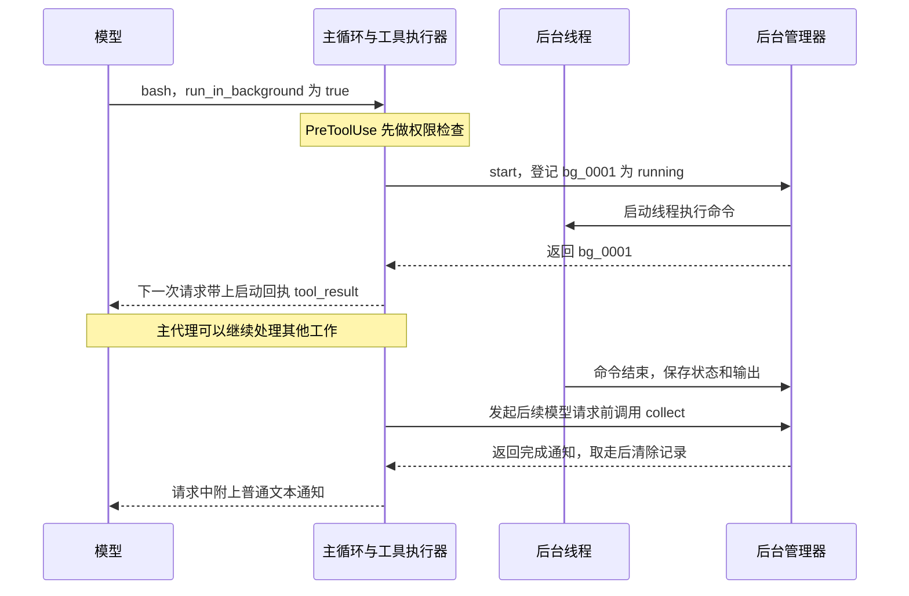

# s11 Background Tasks · 后台任务工作流程

> 对应章节：[learn-claude-code s11_background_tasks](https://github.com/shareAI-lab/learn-claude-code/tree/main/s11_background_tasks)  
> 学习进度：**11 / 17 章**  
> 整理日期：2026-11-10

假设主代理要跑一条需要 30 秒的测试命令。这 30 秒里，它还可以查看项目结构或阅读其他文件。第 11 章让主代理**提交命令后先拿到任务 ID，等后台跑完，再在后续模型请求里带上结果**。适合放到后台的是能独立执行的命令。下一步必须依赖命令结果时，前台执行更直接。

## 1. 主循环在哪里等？

`Popen()` 启动命令并返回一个进程对象。`communicate()` 读取标准输出和错误输出，同时等进程退出。**谁调用 `communicate()`，谁就在这里等。**

| 执行方式 | 谁等命令结束 | 主循环先收到什么 |
|---|---|---|
| 前台，省略开关或传 `false` | 主线程 | 命令的最终输出 |
| 后台，传 `run_in_background: true` | 后台线程 | 启动回执，例如 `[Background task bg_0001 started]` |

两条路径共用 `_run_bash_process()`。它返回 `(输出, 退出码)`。后台管理器用退出码判断状态，`0` 是 `completed`，其他情况是 `failed`。比如超时会返回超时提示和 `None`。退出码比猜输出里有没有 “Error” 可靠。 [进程执行代码](../agent/tools/shell.py)

## 2. 从提交到收到结果



读图时注意两条回传消息的分工：

1. **启动回执**是原始工具调用的 `tool_result`，带上模型给的 `tool_use_id`，告诉模型「这次提交已受理」。
2. **完成通知**是普通 `text` 块，用程序生成的 `bg_0001` 关联后台任务，包含状态、命令和最多 500 字符的输出预览。

图里假设命令运行得较慢。命令如果很快结束，回执和通知可以出现在同一次请求里。主循环每次请求模型前主动收取通知。如果程序正在等用户输入，通知会留在管理器里，等下一次模型请求再送出。 [通知注入代码](../agent/background.py) · [模型请求前的收取位置](../agent/loop.py)

## 3. 分开读四个文件

| 文件 | 重点看哪里 | 它负责什么 |
|---|---|---|
| [agent/tools/registry.py](../agent/tools/registry.py) | `main_base_tools` | 给主代理的 `bash` 增加可选布尔参数 `run_in_background` |
| [agent/tools/executor.py](../agent/tools/executor.py) | `execute_tool()` | 先检查权限，再决定等待命令还是提交后台 |
| [agent/tools/shell.py](../agent/tools/shell.py) | `_run_bash_process()` | 启动进程、读取输出和退出码、处理超时与清理 |
| [agent/background.py](../agent/background.py) | `start()` → `_run()` → `collect()` | 生成 ID、交给线程执行、收取完成结果 |

执行器里有两个布尔参数。`run_in_background` 是模型对这条命令的选择。`allow_background` 是 Python 调用方给执行器的许可。当前只有主循环传 `allow_background=True`，因为完成通知也由它收取。子代理继续使用前台命令。权限检查放在分流之前，所以拒绝的调用会在启动线程前返回。 [主代理执行入口](../agent/loop.py) · [子代理执行入口](../agent/subagents.py)

## 4. 后台管理器为什么要用锁？

后台线程和主线程共用三份内存数据：

| 数据 | 用途 |
|---|---|
| `tasks` | 通过后台 ID 查到命令、原始工具调用 ID 和状态 |
| `results` | 通过后台 ID 查到已结束命令的输出 |
| `_ready` | 记录哪些后台 ID 已结束，等主循环领取 |

后台线程发布结果时，在同一个锁里做三件事。下面是 `_run()` 中的核心片段，省略了前面的命令执行和错误处理。 [后台管理器实现](../agent/background.py)

```python
with self._lock:
    task = self.tasks.get(task_id)
    if task is None:
        return

    # 先存好状态和输出，再把 ID 放进待领取列表。
    # 同一把锁也保护 collect()，它只会看到准备完整的结果。
    task["status"] = status
    self.results[task_id] = result
    self._ready.append(task_id)
```

命令执行和等待发生在锁外，所以主循环仍能进锁取其他已完成的结果。`collect()` 在锁内取走对应记录并清空 `_ready`，随后在锁外拼装通知。这就是为什么同一个结果只能收取一次。

第 10 章的任务记录保存在 `.tasks`，可以跨进程重启保留依赖和状态。第 11 章的后台记录随当前程序进程存活，主要用于追踪一次命令的执行和交付结果。

## 5. 在 Windows 上亲手验证

在项目根目录的 PowerShell 运行已有的验收脚本。它会提交一条约三秒的本地命令，观察提交和收取之间的时间差。 [check_background.py](../check_background.py)

```powershell
.\.venv\Scripts\python.exe check_background.py
```

1. 启动后先看到 `started: bg_0001`，立即收集通常是 `[]`。
2. 五秒后收集到 `<task_notification>`，状态是 `completed`。命令把输出重定向到了 `nul`，所以摘要是 `(no output)`。
3. 再收集一次得到 `[]`，因为刚才已经取走通知。

这个脚本直接验证管理器。想观察完整的模型调用链，可以启动 `main.py`，请模型用 `run_in_background: true` 执行 `echo background done`，然后留意启动回执和 `[background] collected` 日志。如果模型已经回复、通知还没收取，再输入一句询问结果即可触发下一次请求。
