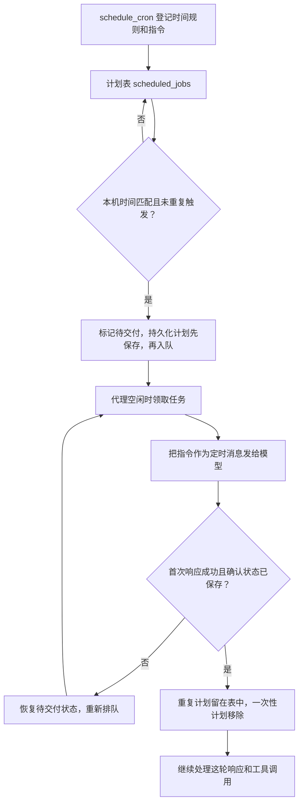

# s12 Cron Scheduler · 定时任务工作流程

> 对应章节：[learn-claude-code s12_cron_scheduler](https://github.com/shareAI-lab/learn-claude-code/tree/main/s12_cron_scheduler)  
> 学习进度：**12 / 17 章**  
> 整理日期：2026-11-10

假设你想让代理每天 09:00 检查测试结果。登记计划时，程序保存**时间规则**和**到点要交给代理的指令**。程序运行期间，定时器看钟，代理空闲时接走任务。第 11 章的后台任务是「现在启动命令，稍后收结果」，第 12 章的定时任务是「到点再开启一轮对话」。

## 1. 一条计划长什么样

例如 `0 9 * * 1-5`，表示周一到周五每天 09:00。

| 顺序 | 分钟 | 小时 | 日 | 月 | 星期 |
|---|---:|---:|---:|---:|---:|
| 表达式 | `0` | `9` | `*` | `*` | `1-5` |
| 允许范围 | 0–59 | 0–23 | 1–31 | 1–12 | 0–6，周日为 0 |

`*` 表示不限，`1-5` 包含两个端点，`9,17` 匹配任意一项，分钟字段的 `*/15` 匹配第 0、15、30、45 分钟。日期和星期都写了限制时，满足其中一项即可。例如 `0 9 1 * 1` 在每月 1 日或周一的 09:00 触发。 [时间匹配与校验](../agent/scheduler.py)

`validate_cron()` 在登记时检查写法，比如拒绝小时 `25` 和步长 `*/0`。`cron_matches()` 在轮询时用给定时间检查已经登记的计划。这样测试可以直接传入 09:00，无需等到那一刻。

## 2. 从登记到交付



### 跟着一次真实场景走

想象程序有两张清单。**计划表**记着「工作日早上 9 点跑测试」这条长期安排。**等待队列**记着「今天这次已经到点，等代理来接」。今天的任务从队列取走后，长期计划还在，明天仍可触发。

**① 08:50，你说「工作日早上 9 点跑测试，并告诉我结果」。** 模型可以用下面的参数调用 `schedule_cron`。工具把中文要求拆成了时间规则 `cron` 和将来要发给代理的指令 `prompt`。

```json
{
  "cron": "0 9 * * 1-5",
  "prompt": "运行项目测试，并告诉我结果。",
  "recurring": true,
  "durable": true
}
```

`schedule_job()` 校验参数后，生成一个类似 `cron_a1b2c3d4` 的 ID，把计划放进 `scheduled_jobs`，并保存到磁盘。此时你看到的是登记回执。以后要查找或取消这条计划，可以用 `list_crons` 或 `cancel_cron`。 [工具入口](../agent/tools/cron_tools.py) · [登记逻辑](../agent/scheduler.py)

**② 09:00，负责看钟的线程发现到点了。** `poll_clock()` 每秒读一次本机时间，交给 `poll_due_jobs()`。它发现「星期符合、小时是 9、分钟是 0」，就把今天这次触发标记为待交付，放进 `cron_queue`。这时终端会显示 `[cron] due`。这一步只负责排队，即使代理正忙，也能记下这次触发。 [时钟与轮询](../main.py) · [入队逻辑](../agent/scheduler.py)

**③ 假设代理正在回答上一条问题，到 09:02 才空下来。** `process_cron_queue()` 和手动回合共用一把 `agent_lock`，可以把它想成「代理使用权」。手动回合持有锁时，定时任务留在队列。上一轮结束后，处理线程拿到锁，取出任务，把 `[Scheduled] 运行项目测试，并告诉我结果。` 放进对话，再走原来的 `agent_loop()`。到这一步，模型才会根据指令决定如何运行测试。即使已经过了 09:00，这次触发也还有效，因为它已在 09:00 入队。 [终端与定时回合](../main.py)

**④ 模型首次响应后，程序确认今天这次任务已经送达。** 终端会显示 `[cron] delivered`。重复计划留在计划表，等下一个工作日。一次性计划在确认后移除。如果首次请求失败，今天这次会放回等待队列，稍后再交给模型。定时回合如果遇到需要人工确认的操作，权限层会直接拒绝，终端输入仍由主线程处理。 [交付确认](../agent/loop.py) · [权限判断](../agent/permissions.py)

## 3. 为什么要记两个状态

假设一条重复计划每天 09:00 触发，当前模型很快就收到了指令。

| 时刻 | 发生什么 | 状态 |
|---|---|---|
| 09:00:01 | 到点入队 | `pending_delivery=True`，`last_fired` 记下今天 09:00 |
| 09:00:03 | 领取任务并请求模型 | 任务已从队列取出，`pending_delivery` 仍是 `True` |
| 09:00:05 | 首次响应成功并确认 | `pending_delivery=False`，保留 `last_fired` |
| 09:00:30 | 定时器再次检查 | 当前分钟等于 `last_fired`，跳过 |

**`pending_delivery` 管的是这次触发有没有交出去，`last_fired` 管的是这一分钟有没有触发过。** 如果模型请求失败，任务可重新排队。如果已经确认交付，后面的工具调用出了问题，本轮会报告错误，避免把已经执行的操作再跑一遍。终端里的 `[cron] delivered` 表示模型已收到指令，实际结果看接下来的输出。

## 4. 关掉程序后，什么能恢复

| 字段 | 控制什么 | 默认值 |
|---|---|---|
| `recurring` | 模型收到指令后，计划保留等下次触发，还是移除 | `True` |
| `durable` | 是否写到工作区的 `.scheduled_tasks.json`，以便重启恢复 | `True` |

两个开关独立。例如 `recurring=False, durable=True` 是一条可跨重启保留的一次性计划。程序先把完整 JSON 写到临时文件，再用 `os.replace()` 替换正式文件。登记、入队或确认时如果保存失败，会恢复对应的内存状态。

已经到点的持久化任务会在入队前保存 `pending_delivery=True`。因此，程序在任务交付前退出时，重启后可以把它恢复到队列。**定时器只在 `main.py` 运行期间看钟**，关机或退出期间错过的触发时刻不会补跑。 [保存与恢复逻辑](../agent/scheduler.py)

## 5. 动手验证

先用固定时间检查匹配规则。这段练习可以在项目根目录的 PowerShell 运行，不调用模型。

```powershell
@'
from datetime import datetime
from agent.scheduler import cron_matches, validate_cron

cron = "0 9 * * 1-5"
assert validate_cron(cron) is None
assert cron_matches(cron, datetime(2026, 11, 10, 9, 0))
assert not cron_matches(cron, datetime(2026, 11, 10, 9, 1))
assert not cron_matches(cron, datetime(2026, 11, 14, 9, 0))
print("Cron matching checks passed.")
'@ | .\.venv\Scripts\python.exe -
```

要观察完整流程，启动 `.\.venv\Scripts\python.exe main.py`，在终端输入：

```text
请用 schedule_cron 创建一次性演示任务。
cron 用 * * * * *，recurring 和 durable 都设为 false。
到点后只回复“定时任务已触发”。
```

保持程序运行。观察终端先出现 `[cron] due`，表示到点入队，再出现 `[cron] delivered`，表示模型收到指令，随后是代理回复。最后请代理调用 `list_crons`，确认这条一次性计划已移除。
