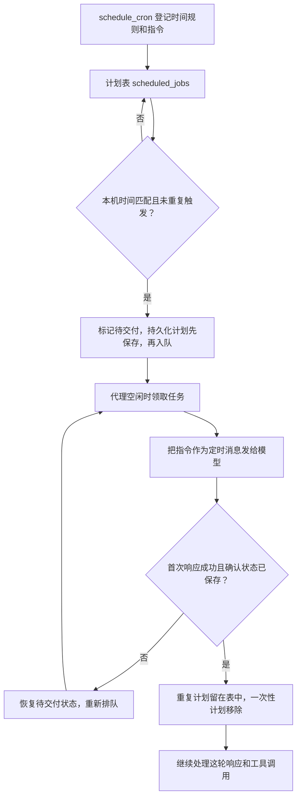

# s12 Cron Scheduler · 定时任务工作流程

> 对应章节：[learn-claude-code s12_cron_scheduler](https://github.com/shareAI-lab/learn-claude-code/tree/main/s12_cron_scheduler)  
> 学习进度：**12 / 17 章**  
> 整理日期：2026-11-10

## 先跟着一条指令走

你早上 08:50 对代理说：「工作日 09:00 帮我跑测试，告诉我结果。」假设今天是工作日，09:00 时代理正忙，09:02 才空下来。

| 时间 | 程序做了什么 | 此时测试开始了吗 |
|---|---|---|
| 08:50 | 把「工作日 09:00 → 跑测试」记进计划表 | 还没，只是记下安排 |
| 09:00 | 看钟的代码发现到点，把今天这次任务放进等待队列 | 还没，代理正在忙 |
| 09:02 | 代理空下来，程序取出指令，像收到一条新消息那样交给模型 | 模型这时才决定怎么跑测试 |

**计划表像日历，队列像待办篮。** 日历上写着「工作日 09:00 跑测试」。到了 09:00，程序往篮子里放一张「今天该跑测试了」的便条。代理拿走便条后，日历上的安排还在，下一个工作日可以再放一张。

第一次读代码，只找这三行。它们分别出现在三个不同的函数里，串起来就是上面三个动作。

```python
scheduled_jobs[job.id] = job  # 登记时，把长期安排记进计划表
cron_queue.append(job)       # 到点时，把这次工作放进等待队列

# 代理空闲后，把指令交给模型。
agent_loop(scheduled_history, request, on_first_response=confirm_delivery)
```

到点时你会看到 `[cron] due`，意思是「便条已放进篮子」。看到 `[cron] delivered`，意思是「模型已收到便条」。等代理回复测试结果，才知道测试实际跑得怎么样。 [计划表与队列](../agent/scheduler.py) · [调用模型的位置](../main.py)

## 1. 一条计划长什么样

例如 `0 9 * * 1-5`，表示周一到周五每天 09:00。

| 顺序 | 分钟 | 小时 | 日 | 月 | 星期 |
|---|---:|---:|---:|---:|---:|
| 表达式 | `0` | `9` | `*` | `*` | `1-5` |
| 允许范围 | 0–59 | 0–23 | 1–31 | 1–12 | 0–6，周日为 0 |

`*` 表示不限，`1-5` 包含两个端点，`9,17` 匹配任意一项，分钟字段的 `*/15` 匹配第 0、15、30、45 分钟。日期和星期都写了限制时，满足其中一项即可。例如 `0 9 1 * 1` 在每月 1 日或周一的 09:00 触发。 [时间匹配与校验](../agent/scheduler.py)

`validate_cron()` 在登记时检查写法，比如拒绝小时 `25` 和步长 `*/0`。`cron_matches()` 在轮询时用给定时间检查已经登记的计划。这样测试可以直接传入 09:00，无需等到那一刻。

## 2. 从登记到交付



上面 08:50 的登记操作里，模型把你的中文要求拆成两部分，再交给 `schedule_cron`。程序看 `cron` 决定何时触发，到点时才把 `prompt` 送给模型。

```json
{
  "cron": "0 9 * * 1-5",
  "prompt": "运行项目测试，并告诉我结果。",
  "recurring": true,
  "durable": true
}
```

`schedule_job()` 为计划生成一个类似 `cron_a1b2c3d4` 的 ID。可以用 `list_crons` 查到这个 ID，再用 `cancel_cron` 取消。 [工具入口](../agent/tools/cron_tools.py)

程序开了两个线程。`poll_clock()` 每秒看一次本机时间，负责往队列里放到点的工作。`process_cron_queue()` 负责取出工作。它和手动回合共用一把 `agent_lock`，就像两个人轮流用同一台电脑。手动回合在用时，定时任务就在队列里等。等你在终端输入下一句话时，代理是空闲的，定时任务也能自行启动。 [终端与定时回合](../main.py)

任务取出后会作为一条新消息加入对话，内容是 `[Scheduled] 运行项目测试，并告诉我结果。`。后续仍走项目原来的模型循环和工具调用。定时回合中遇到需要人工确认的操作会被拒绝，终端输入继续由主线程负责。 [模型循环](../agent/loop.py) · [权限判断](../agent/permissions.py)

## 3. 为什么要记两个状态

假设一条重复计划每天 09:00 触发，当前模型很快就收到了指令。

| 时刻 | 发生什么 | 状态 |
|---|---|---|
| 09:00:01 | 到点入队 | `pending_delivery=True`，`last_fired` 记下今天 09:00 |
| 09:00:03 | 领取任务并请求模型 | 任务已从队列取出，`pending_delivery` 仍是 `True` |
| 09:00:05 | 首次响应成功并确认 | `pending_delivery=False`，保留 `last_fired` |
| 09:00:30 | 定时器再次检查 | 当前分钟等于 `last_fired`，跳过 |

**`pending_delivery` 管的是这次触发有没有交出去，`last_fired` 管的是这一分钟有没有触发过。** 如果模型请求失败，任务可重新排队。如果已经确认交付，后面的工具调用出了问题，本轮会报告错误，避免把已经执行的操作再跑一遍。终端里的 `[cron] delivered` 表示模型已收到指令，实际结果看接下来的输出。

## 4. 关掉程序后，什么能恢复

| 字段 | 控制什么 | 默认值 |
|---|---|---|
| `recurring` | 模型收到指令后，计划保留等下次触发，还是移除 | `True` |
| `durable` | 是否写到工作区的 `.scheduled_tasks.json`，以便重启恢复 | `True` |

两个开关独立。例如 `recurring=False, durable=True` 是一条可跨重启保留的一次性计划。程序先把完整 JSON 写到临时文件，再用 `os.replace()` 替换正式文件。登记、入队或确认时如果保存失败，会恢复对应的内存状态。

已经到点的持久化任务会在入队前保存 `pending_delivery=True`。因此，程序在任务交付前退出时，重启后可以把它恢复到队列。**定时器只在 `main.py` 运行期间看钟**，关机或退出期间错过的触发时刻不会补跑。 [保存与恢复逻辑](../agent/scheduler.py)

## 5. 动手验证

先用固定时间检查匹配规则。这段练习可以在项目根目录的 PowerShell 运行，不调用模型。

```powershell
@'
from datetime import datetime
from agent.scheduler import cron_matches, validate_cron

cron = "0 9 * * 1-5"
assert validate_cron(cron) is None
assert cron_matches(cron, datetime(2026, 11, 10, 9, 0))
assert not cron_matches(cron, datetime(2026, 11, 10, 9, 1))
assert not cron_matches(cron, datetime(2026, 11, 14, 9, 0))
print("Cron matching checks passed.")
'@ | .\.venv\Scripts\python.exe -
```

要观察完整流程，启动 `.\.venv\Scripts\python.exe main.py`，在终端输入：

```text
请用 schedule_cron 创建一次性演示任务。
cron 用 * * * * *，recurring 和 durable 都设为 false。
到点后只回复“定时任务已触发”。
```

保持程序运行。观察终端先出现 `[cron] due`，表示到点入队，再出现 `[cron] delivered`，表示模型收到指令，随后是代理回复。最后请代理调用 `list_crons`，确认这条一次性计划已移除。
