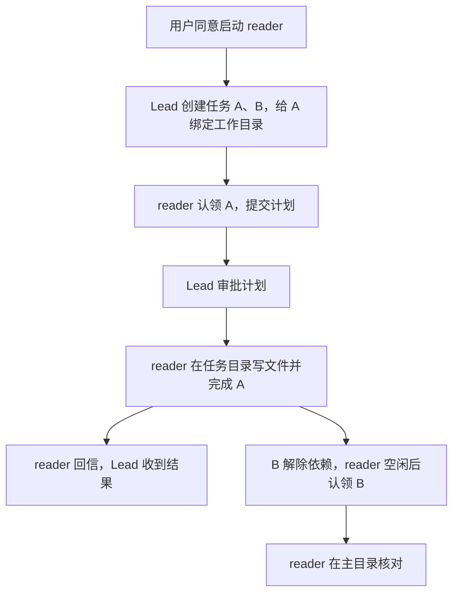
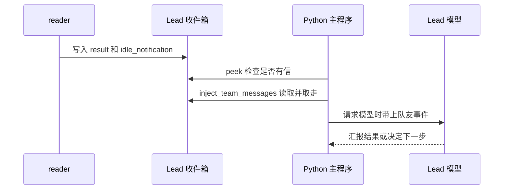
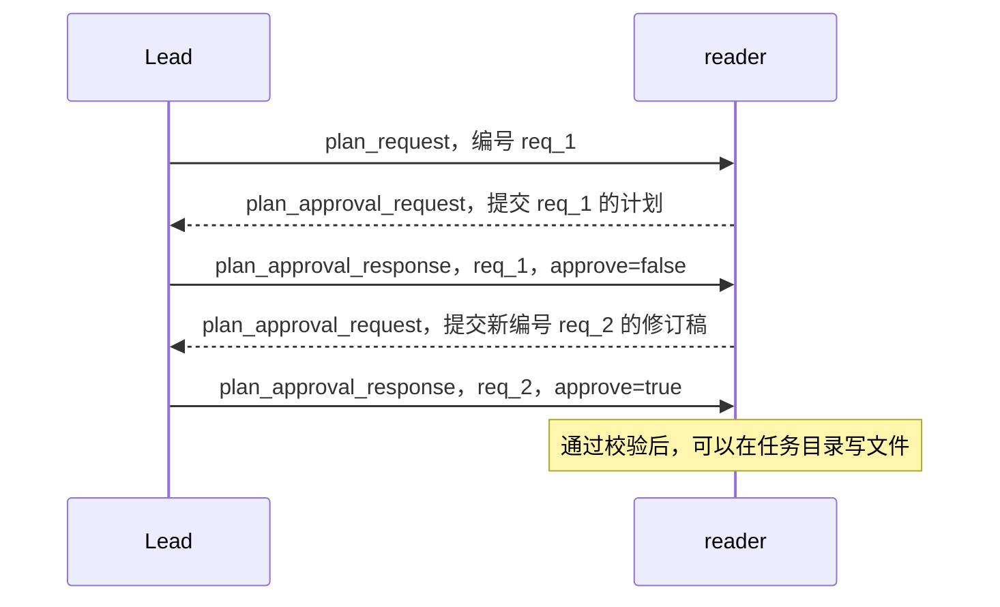

# s13 Agent Teams · 队友怎样领任务、改文件和回信

> 对应章节：[learn-claude-code 第 13 章中文解说](https://github.com/shareAI-lab/learn-claude-code/blob/main/s13_agent_teams/README.zh.md)  
> 学习进度：**13 / 17 章**  
> 整理日期：2026-11-11

## 先跟着 reader 做一件小事

你对主代理说「让 `reader` 写一个演示文件，先给我看看它打算怎么做」。这里的主代理叫 **Lead**，也就是与你对话、协调队友的人。我们把工作分成两项。

| 任务 | 要做什么 | 在哪里做 |
|---|---|---|
| A | 新建 `playground/team-demo.txt`，写入 `hello from reader` | 独立工作目录 `.worktrees/team-demo` |
| B | 检查主项目目录里是否出现了同名文件 | 主项目目录，等 A 完成后再查 |

如果主目录原先没有这个文件，最后应该看到 **A 的目录里有新文件，主目录里仍找不到同名文件**。B 要等 A 完成，因为它要验证「A 写过文件以后，主目录里是什么样」。这个例子会用到第 13 章的三样东西。

- **任务板**记录要做什么、谁在做、要等哪项任务。它保存到 `.tasks`。
- **收件箱**负责把指令、计划、审批和结果交给指定的人。它保存到 `.mailboxes`。
- **Git 工作目录**决定队友手上的任务到哪里读写文件。它放在 `.worktrees`。



## 1. Lead 怎样把第一项任务交给 reader

1. Lead 先说明为什么需要队友，以及每个人负责什么。得到你的确认后，它才按系统提示启动队友。 [Lead 的团队提示](../agent/config.py)
2. Lead 调用两次 `create_task`，拿到 A 和 B 各自的真实 ID，再用 `update_task` 给 B 加上「等 A 完成」的依赖。ID 是程序生成的，表格里的 A、B 是讲解用的名字。接着，Lead 调用 `create_worktree` 给 A 绑定 `team-demo`。 [任务工具](../agent/tools/task_tools.py) · [创建工作目录](../agent/worktrees.py)
3. 假设 A 的 ID 是 `task_1a2b3c4d`，Lead 调用 `spawn_teammate(name="reader", task_id="task_1a2b3c4d", require_plan=True)`。`TeamManager.spawn_teammate()` 先替 `reader` 认领 A，记录这项任务要求审批，再启动队友线程。认领失败会在启动前返回错误。 [工具入口](../agent/tools/team_tools.py) · [启动队友的代码](../agent/teams.py)

**为什么先认领再启动？** 队友一开始就知道手里是哪张任务单、应该在哪里工作。如果等线程启动后再安排，这段间隙里，它已经可能去任务板挑选其他任务了。

`TeammateRuntime` 有自己的 `self.messages`。第一次收到任务和后面收到追问时，它使用的是同一份队友对话。Lead 继续使用自己的对话。两边分别请求模型，跨线程通过收件箱传递消息。底层的工具调用循环复用 `run_subagent_turn()`。 [队友工作循环](../agent/teams.py) · [模型与工具调用循环](../agent/subagents.py)

### 和前面两种后台工作的关系

| 功能 | 交给谁 | 完成之后怎样 |
|---|---|---|
| `task` 子代理 | 一次独立的模型回合，使用自己的临时对话 | 返回总结，这次调用结束 |
| `bash(run_in_background=True)` | 后台线程里的一个 Shell 命令 | 收集命令状态和输出 |
| `spawn_teammate` | 有名字和收件箱的长期队友 | 发回结果，再等下一封信或下一项任务 |

比如「跑一次测试」可以交给后台命令。「持续负责文档修改，先交方案，改完等我追问」需要队友的对话、消息和任务状态。 [子代理](../agent/subagents.py) · [第 11 章笔记](s11-background-tasks.md) · [队友运行时](../agent/teams.py)

## 2. 一封信怎样从 reader 到 Lead

`MessageBus.send()` 根据收件人找文件。发给 `reader` 的信追加到 `.mailboxes/reader.jsonl`，发给 Lead 的信追加到 `.mailboxes/lead.jsonl`。JSONL 的意思是「每封信占一行」。下面是省略发送时间的结果消息。

```json
{"from":"reader","to":"lead","type":"result","content":"演示文件已写入并核对。","metadata":{}}
```

| 代码 | 在这个例子中做什么 |
|---|---|
| `send()` | 追加一封信，写完后通知正在等待的队友线程 |
| `wait_for_messages()` | `reader` 等自己的收件箱。有信就取走，等了两秒仍无信才找任务 |
| `peek()` | 查看 Lead 收件箱是否有信，保留内容供主循环读取 |
| `read_inbox()` | 读完整批消息后移除收件箱文件，让这批信只取一次 |

`send()` 和读取使用同一把锁。`reader` 等待时会暂时放开锁，发信的人才能写入。写完发出通知后，`reader` 醒来再检查自己的收件箱。这些动作由 Python 线程执行。 [收件箱的读写和等待](../agent/mailboxes.py)



你停在终端输入框时，`main.py` 的 `process_pending_turns()` 仍会检查回信。它和手动输入共用 `agent_lock`，这样两个回合就不会同时改 Lead 的对话。Lead 空闲时，`run_team_turn()` 发起一轮对话。如果 Lead 正在处理你刚发的消息，`agent_loop()` 会在下次请求模型前调用 `inject_team_messages()`，把信变成类似 `[Team result from reader]` 的文本块。队友完成后，你可以直接等终端显示 Lead 的回复。 [空闲时触发回合](../main.py) · [每次请求前取信](../agent/loop.py) · [消息转成文本块](../agent/teams.py)

**`result` 说的是「这一轮做出了什么」。`idle_notification` 说的是「这一轮结束，线程回到等信」。** 要确认任务是否真的完成，看任务单的 `status`。如果仍是 `in_progress`，同一个队友会保留原任务，等后续指令或继续处理，认领新任务的检查会拦住它。 [回合结束与回信](../agent/teams.py) · [自动认领检查](../agent/tasks.py)

## 3. 两个队友同时看到一项任务，谁领得到

假设 A 已经完成，`reader` 和 `writer` 都看到 B 可以开始。`claim_next_task()` 先找候选任务，最终都要经过 `claim_task()`。

| 顺序 | 发生了什么 |
|---|---|
| ① | `reader` 拿到任务存储锁，从磁盘读取 B，看到 `pending` 且无人负责 |
| ② | 程序检查 B 的依赖已完成，确定工作目录，将 `owner="reader"` 和 `status="in_progress"` 保存 |
| ③ | `reader` 释放锁。轮到 `writer` 重新读 B 时，它读到的是第 ② 步已保存的状态，认领被拒绝 |

锁把「读取、判断、写入」连成一次操作。线程之间用 `RLock`，不同进程再共用任务目录里的文件锁。写任务时，`TaskStore.save()` 先写好临时文件，再替换正式 JSON。这让其他读取者看到的是一份完整记录。 [任务存储、加锁与认领](../agent/tasks.py)

队友调用 `complete_task` 时只提交任务 ID，`TeammateRuntime.finish_task()` 用自己的 `self.name` 补上负责人。即使 `reader` 知道 `writer` 的任务 ID，也无法把对方的任务标记完成。A 完成后，B 的前置条件满足，空闲队友下次找任务时就能认领它。 [队友绑定负责人](../agent/teams.py) · [完成任务与检查依赖](../agent/tasks.py)

## 4. 同样的文件名，怎么确保改的是任务目录那一份

### 先创建目录，再写回任务单

`create_worktree("team-demo", "task_1a2b3c4d")` 先检查任务仍是待办、无人认领，名称和路径可用。然后从当前 Git 提交 `HEAD` 创建分支 `wt/team-demo`，把这一版文件检出到 `.worktrees/team-demo`。Git 成功后，任务单才写入 `"worktree": "team-demo"`。如果你的主目录里有尚未提交的修改，新目录从已提交的版本开始。 [本项目的创建逻辑](../agent/worktrees.py) · [Git worktree 官方文档](https://git-scm.com/docs/git-worktree)

### 工具执行时，从任务里取目录

假设 `reader` 调用 `write_file(path="playground/team-demo.txt", ...)`。跟着代码读这四步。

1. `TeammateRuntime.dispatch_tool()` 找到 `reader` 当前的任务分配，也就是 `TaskAssignment`。
2. A 有 worktree，`task_worktree_cwd()` 会检查目录和 Git 登记，再返回 `.worktrees/team-demo` 对应的完整路径。B 没绑定 worktree，它返回项目根目录。如果 A 的绑定目录丢失，程序会报错，阻止工具误写主目录。
3. `dispatch_tool()` 把目录放进当前调用的 `TOOL_CWD`。文件工具据此拼出真实路径，权限检查使用同一个起点，Shell 则用它作为子进程的启动目录。
4. 工具调用结束后，`finally` 恢复调用前的 `TOOL_CWD`。各线程共享同一个 Python 进程，所以代码给每次调用单独传目录，队友之间可以同时在各自的目录工作。

```python
# agent/teams.py 中的 dispatch_tool 关键几行
token = TOOL_CWD.set(assignment.cwd)
try:
    return execute_tool(block, handlers)
finally:
    TOOL_CWD.reset(token)
```

队友还没领任务时，文件和 Shell 工具会提示先认领。领到 A 后，相对路径从任务目录开始。Shell 的起始目录由程序设置，后续命令仍受进程权限和已有 Shell 检查约束。 [工具目录的传递](../agent/teams.py) · [目录校验](../agent/worktrees.py) · [文件工具](../agent/tools/files.py) · [Shell 工具](../agent/tools/shell.py) · [权限判断](../agent/permissions.py)

### 为什么点了「完成」还要等一会儿才能清理

同一批工具里可能先有 `complete_task`，后面还有一次读文件。标记完成时，代码先更新任务单的状态，队友这一轮继续用 A 的目录。等 `run_turn()` 返回，`release_completed_assignment()` 才释放目录。这样最后一次读取仍会拿到 A 的文件。

`remove_worktree()` 是供宿主调用的清理函数。它会检查任务已完成、目录已释放，默认也会拒绝有已跟踪改动、未跟踪文件或忽略文件的目录。成功移除后，它会清空任务上的绑定并保留 `wt/team-demo` 分支。要把队友提交的修改带回主分支，还需要在 Git 中合并。 [释放任务分配](../agent/tasks.py) · [清理工作目录](../agent/worktrees.py)

## 5. 计划怎样从「待批」变成「可以动手」

启动团队的确认由用户给。队友交上来的每份计划，由 Lead 通过 `review_plan` 发回决定。对 A 来说，第一轮允许读文件和搜索，写入、编辑和执行 Shell 命令要等计划获批。



图中的 `req_1` 和 `req_2` 是便于阅读的编号，实际运行会生成类似 `req_1a2b3c4d` 的 ID。先看三个位置。

| 在哪看 | 做了什么 | 为什么 |
|---|---|---|
| `request_plan()` | 发出计划要求时记录当前任务 ID 和请求编号 | 队友还没读到信时，后续写入也要先经过检查 |
| `draft_plan()` | 调用模型时只提供 `read_file` 和 `glob`，写完把计划交回 Lead | 计划可以依据项目文件，审批前的工具范围由程序限制 |
| `apply_plan_review()` | 核对发件人、收件人、请求编号、审批值和当前任务 | 发给旧稿或另一项任务的审批不能打开当前的写入权限 |

例如 Lead 驳回了旧稿，又误发了一封批准旧稿的信。此时 `pending_plan_id` 已经是修订稿编号，编号对不上，程序会忽略这封信。等新稿获批，`dispatch_tool()` 才让后续写入通过计划检查。 [计划请求、工具检查与审批](../agent/teams.py)

### 关闭队友也要对上请求编号

Lead 调用 `request_shutdown("reader")` 时，管理器登记一个请求编号，再发出 `shutdown_request`。队友处理完当前回合，在收件箱读到请求后，带上同一个编号发送 `shutdown_response`，然后退出线程。Lead 收信时会核对编号并取走这条待确认记录。线程退出时还会释放任务分配，尚未完成的任务回到 `pending`，其他队友可以接手。 [关闭请求和回执](../agent/teams.py) · [退出时归还任务](../agent/tasks.py)

## 6. 打开代码时按这个顺序找

| 文件 | 搜索函数名 | 阅读时想清楚的问题 |
|---|---|---|
| [agent/tools/team_tools.py](../agent/tools/team_tools.py) | `run_spawn_teammate` | 模型交来的队友名、任务 ID、计划开关传到哪里？ |
| [agent/teams.py](../agent/teams.py) | `spawn_teammate`、`_run` | 为什么先领任务再开线程？队友什么时候去看任务板？ |
| [agent/mailboxes.py](../agent/mailboxes.py) | `send`、`wait_for_messages` | 发信写哪个文件？队友等信时怎样让发送方写入？ |
| [agent/tasks.py](../agent/tasks.py) | `claim_task`、`complete_task` | 谁能修改状态？两个人同时认领会怎样？ |
| [agent/worktrees.py](../agent/worktrees.py) | `create_worktree`、`task_worktree_cwd` | 什么时候写入任务绑定？目录丢了会怎样？ |
| [agent/teams.py](../agent/teams.py) | `dispatch_tool`、`apply_plan_review` | 待批时哪些工具会被拦？批准后工具从哪个目录开始？ |
| [main.py](../main.py) | `run_team_turn` | 用户没输入下一句话时，Lead 怎样开始处理回信？ |

## 7. 用终端走一遍

在项目根目录用 PowerShell 启动程序。

```powershell
.\.venv\Scripts\python.exe -B main.py
```

把下面这段发给 Lead。如果以前用过 `team-demo` 这个目录名，可以把工作目录和演示文件都换成一组新名字。

> 请安排 `reader` 完成两项任务。A 在名为 `team-demo` 的 Git 工作目录里创建 `playground/team-demo.txt`，内容是 `hello from reader`。A 开始前先提交计划，请你审批。B 等 A 完成后，在主项目目录核对是否出现了同名文件。请先向我说明安排，等我同意再启动队友。做完后汇报结果，并保留工作目录供我查看。

Lead 提出方案后回复「同意启动」。如果想亲眼看一下结果，可以另开一个 PowerShell 窗口，在同一项目根目录运行这些查看命令。

```powershell
git worktree list
Get-Content -LiteralPath '.\.worktrees\team-demo\playground\team-demo.txt'
Test-Path -LiteralPath '.\playground\team-demo.txt'
```

第一行应列出 `wt/team-demo` 所在的工作目录。第二行应读到 `hello from reader`。如果主目录原先没有该文件，第三行应输出 `False`。结合终端的 `[claim]`、`[complete]` 和 Lead 回复，可以对照本章开头的 A、B 顺序。

实现验收在临时 Git 仓库中使用模拟模型回复。实际执行了 Git、文件读写和 Shell，检查了旧审批、同轮目录保留、重复认领以及清理条件。上面的终端练习用来观察真实模型怎样安排工具调用。
