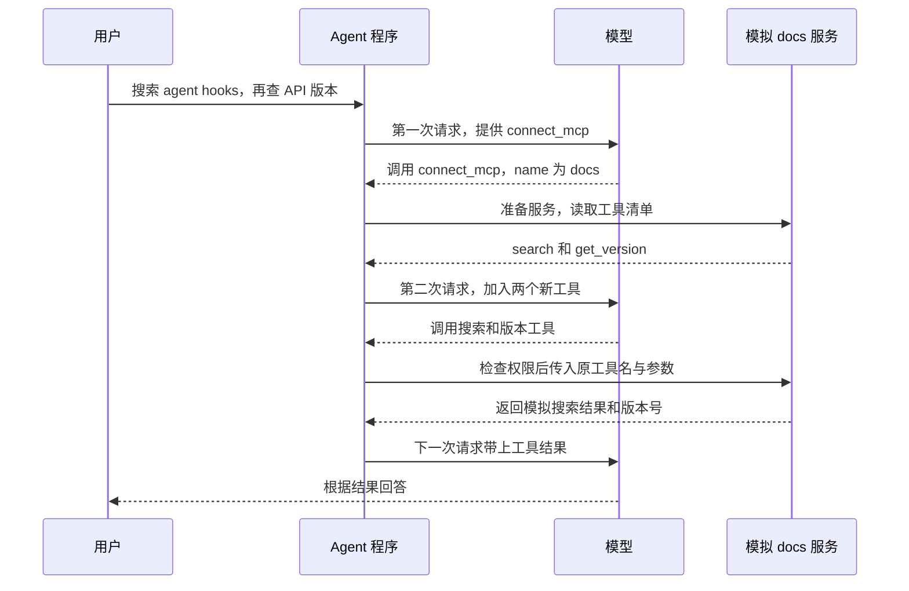

# s14 MCP Tools · Agent 怎样发现并调用外部工具

> 对应章节：[原项目第 14 章中文解说](https://github.com/shareAI-lab/learn-claude-code/blob/main/s14_mcp_plugin/README.zh.md)
>
> 学习进度：**14 / 17 章**

## 先弄清楚 MCP 是什么

假设你说：「帮我查一下文档里的 `agent hooks`，再告诉我文档 API 的版本。」

AI 应用要先问文档服务「你能做什么？」。文档服务回答「我能搜索，也能查版本。搜索时请给我关键词」。应用接着问「请搜索 `agent hooks`」。文档服务做完后，把结果交回来。

**MCP（Model Context Protocol，模型上下文协议）是双方约好的通信格式。** 在工具这部分，问「你有哪些工具」用 `tools/list`，请对方执行一个工具用 `tools/call`。以后接另一个服务，也可以用相同的方式发现工具并调用。 [MCP 官方架构说明](https://modelcontextprotocol.io/docs/learn/architecture)

| 角色 | 用这个例子理解 |
|---|---|
| 宿主（Host） | 你正在写的 Agent 程序，负责把工具清单交给模型、接住调用请求、检查权限 |
| 客户端（Client） | 宿主里负责和 MCP 服务收发消息的部分 |
| 服务端（Server） | 提供工具的程序，例如提供搜索和版本查询的文档服务 |

这一章先把 `docs` 和 `deploy` 模拟在同一个 Python 进程里。你可以用 `MCPClient` 读取已经准备好的工具清单，也可以调用其中的 Python 函数。这两步分别对应真实 MCP 的工具发现和工具调用。搜索结果、版本号和部署回执都是练习用的固定文本。 [原项目第 14 章的模拟范围](https://github.com/shareAI-lab/learn-claude-code/blob/main/s14_mcp_plugin/README.zh.md)

## 1. 用一句话走完整个流程



图里用两次查询在同一批调用里做示例。实际先查哪一个、要分几次，由模型决定。连接发生在两次模型请求之间，因此你只输入一句话，程序里可以发生好几次模型请求。每次请求前，`agent_loop()` 都重新组装工具清单。 [主循环](../agent/loop.py) · [工具组装](../agent/tools/registry.py)

## 2. 连接 docs 得到什么

从 `agent/mcp.py` 的 `connect_mcp("docs")` 看起。它先查下面两个字典。

| 字典 | 刚启动时是什么 | 连上 docs 后是什么 |
|---|---|---|
| `MOCK_SERVERS` | 有 `docs` 和 `deploy`，值是创建服务的函数 | 仍是那份可连接的名单 |
| `mcp_clients` | 空字典 | `"docs"` 对应已经准备好的 `MCPClient` 对象 |

第一次连接时，`MOCK_SERVERS.get("docs")` 取到 `_mock_server_docs`，走到 `factory()` 才真正运行它。函数创建对象，调用 `register()`，把 `search` 和 `get_version` 登记进去。连接函数把对象留在 `mcp_clients`，以后查询时可以直接取用。再次连接 `docs` 会发现它已经登记。 [模拟服务和连接代码](../agent/mcp.py)

**为什么每个工具要登记两份信息？** `tool_defs` 里的说明告诉模型 `search` 要传什么。对于搜索，`properties` 指定 `query` 是字符串，`required` 指定它必须出现。`handlers` 里的 `"search": search` 则告诉 Python 收到这个名字时要执行哪个函数。它和以前工具表里的 `"read_file": run_read` 是同一个思路。 [MCPClient 的登记方法](../agent/mcp.py) · [已有的文件工具](../agent/tools/base.py)

## 3. 模型怎样看见刚发现的工具

连接前，模型能调用 `connect_mcp`。连接后，下一次请求的工具清单里多了 `mcp__docs__search` 和 `mcp__docs__get_version`。跟着 `assemble_tool_pool()` 看，这次组装做了三件事。

1. **先复制原有工具表。** 每轮都在新列表、新字典里加工具，下一轮再从原表开始，避免重复追加。
2. **把服务的说明翻成模型接口的格式。** 服务给的是 `search` 和 `inputSchema`。给模型时，名字变为 `mcp__docs__search`，参数说明的键变为 `input_schema`。服务名用来区分不同服务里的同名工具。如果 `look.up` 和 `look_up` 规范化后撞名，组装函数会报错，避免后者覆盖前者。
3. **把执行函数和权限一起登记。** `_make_mcp_handler(docs, "search")` 返回一个记住服务对象和原工具名的函数。模型使用完整名字，执行函数会转回原名，调用 `docs.call_tool("search", 参数字典)`。权限表也会记下完整名字对应的规则。 [工具说明、执行函数和权限组装](../agent/tools/registry.py)

模型请求里的 `system` 和 `tools` 可以这样分辨。**`system` 说「已经连了 docs」，`tools` 说「可以用哪些工具、要填哪些参数」。** 主循环每次发请求都用 `append_mcp_status()` 补上当前连接名单，所以连接状态会跟上工具清单的变化。 [系统提示](../agent/prompts.py) · [发送模型请求](../agent/loop.py)

## 4. 参数怎样一路传进 search

模型发来的工具名是 `mcp__docs__search`，参数是 `{"query": "agent hooks"}`。现有的 `execute_tool()` 会先检查权限，再找执行函数。执行函数把参数字典交给 `MCPClient.call_tool()`。走到 `handler(**args)` 时，Python 会展开字典，把键当成参数名。

```python
search(**{"query": "agent hooks"})
# 上面这行等同于 search(query="agent hooks")
```

如果参数字典是 `{}`，Python 调用 `search()` 时会报缺少 `query`。`call_tool()` 捕获异常，把它转成以 `MCP error: TypeError:` 开头的文字。主循环仍会把这条文字作为 `tool_result` 送回模型。模型知道缺了哪个参数，就可以补上再试。 [工具执行器](../agent/tools/executor.py) · [MCP 工具调用](../agent/mcp.py) · [工具结果回到对话](../agent/loop.py)

## 5. 模型能看见工具，执行时还要检查权限

同样是连上 `deploy` 后发现的工具，查看状态和触发部署走不同的规则。

| 工具名 | 宿主规则 | 执行时会看到什么 |
|---|---|---|
| `mcp__docs__search`、`mcp__docs__get_version` | `allow` | 直接查询 |
| `mcp__deploy__status` | `allow` | 直接返回模拟运行状态 |
| `mcp__deploy__trigger` | `confirm` | 终端询问 `Allow? [y/N]`，输入 `y` 才执行 |
| 权限表里没配置的 MCP 工具 | 默认确认 | 执行前同样询问 |

规则原本用 `("deploy", "trigger")` 当键，所以不同服务即使都叫 `trigger`，也能单独配置。组装工具表时换成模型使用的完整名字。`PreToolUse` 是工具执行前的检查点，它用完整名字找到权限。如果你拒绝，执行器就返回 `Permission denied.`。服务自己提供的 `readOnlyHint` 只是描述，程序查的是你写的 `MCP_HOST_POLICY`。后台回合需要确认时会直接拒绝，终端输入由主线程负责。 [宿主权限表](../agent/mcp.py) · [权限检查](../agent/permissions.py) · [执行前检查](../agent/tools/executor.py)

## 6. 打开代码，按这个顺序找

| 文件 | 搜索关键字 | 想清楚的问题 |
|---|---|---|
| [agent/mcp.py](../agent/mcp.py) | `connect_mcp` | 输入 `docs` 后，程序从哪里找到创建服务的函数？ |
| [agent/mcp.py](../agent/mcp.py) | `_mock_server_docs`、`call_tool` | 哪一处说明要传 `query`？哪一处真正执行搜索？ |
| [agent/tools/registry.py](../agent/tools/registry.py) | `CONNECT_MCP_TOOL`、`assemble_tool_pool` | 连接工具什么时候可见？搜索工具什么时候可见？ |
| [agent/loop.py](../agent/loop.py) | `assemble_tool_pool()`、`tool_use_id` | 为什么在循环里面组装？执行结果怎样和原调用对上？ |
| [agent/permissions.py](../agent/permissions.py) | `check_rules`、`ask_user` | 为什么查状态可以直接执行，触发部署要先问？ |

## 7. 自己跑一次

### 先直接验证工具，无需请求模型

在项目根目录的 PowerShell 里运行：

```powershell
@'
from types import SimpleNamespace

from agent.tools.executor import execute_tool
from agent.tools.registry import assemble_tool_pool

name = "mcp__docs__search"
_, handlers = assemble_tool_pool()
print("Before:", name in handlers)

call = SimpleNamespace(name="connect_mcp", input={"name": "docs"})
print(execute_tool(call, handlers))

_, handlers = assemble_tool_pool()
print("After:", name in handlers)

for args in ({"query": "agent hooks"}, {}):
    call = SimpleNamespace(name=name, input=args)
    print(execute_tool(call, handlers))
'@ | .\.venv\Scripts\python.exe -B -
```

重点看 `Before: False`、`After: True`。再看两个搜索结果。带关键词的一次会输出 `[docs] Found 3 results for 'agent hooks'`。故意漏传的那次会返回提示缺少 `query` 的错误文字。

### 再用终端和模型走一遍

```powershell
.\.venv\Scripts\python.exe -B main.py
```

> 连接 docs 服务，搜索 agent hooks，再告诉我文档 API 的版本。

对照终端里的三个工具名 `connect_mcp`、`mcp__docs__search` 和 `mcp__docs__get_version`。还可以输入「连接 deploy 服务，查询 web 的部署状态」，观察查询是否直接返回。想看确认流程时，可以请求模拟触发 `web` 部署，在提示处按回车，观察 `Permission denied.`。
