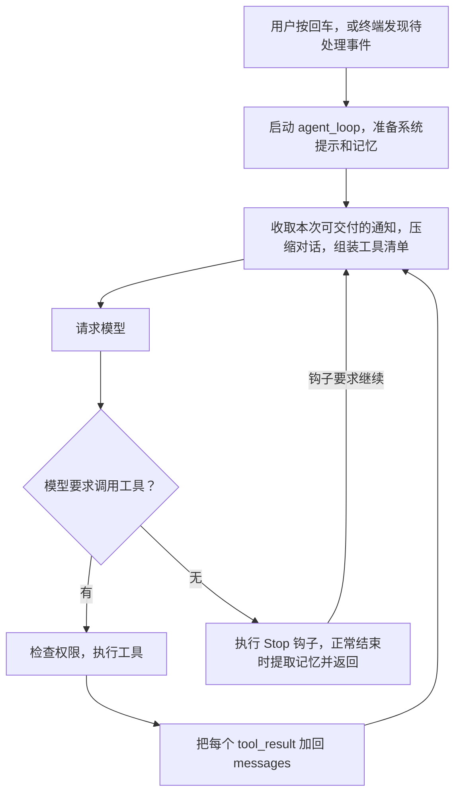

# s15 Agent Harness 集成 · 一句话怎样走完整个主循环

> 对应章节：[原项目第 15 章中文解说](https://github.com/shareAI-lab/learn-claude-code/blob/main/s15_integrated_harness/README.zh.md)
>
> 学习进度：**15 / 17 章**

## 先从一次完整运行开始

你对代理说：「查一下文档 API 的版本，再在后台运行一条演示命令。命令启动后先告诉我，跑完再报结果。」

| 顺序 | 你能看到什么 | Python 程序在做什么 |
|---|---|---|
| ① 你按回车 | 终端开始处理你的问题 | 把问题加进对话，启动 `agent_loop()` |
| ② 模型要连接文档服务 | 日志出现 `connect_mcp` | 执行连接，发现 `docs` 的工具。下一次请求模型前重建工具清单 |
| ③ 模型查版本，申请运行命令 | 显示版本结果，终端询问是否执行 Shell | 查版本直接放行。批准 Shell 后，启动后台线程并立即返回任务 ID |
| ④ 模型说「已启动」 | 终端回到输入框 | 当前对话回合结束，后台线程继续执行命令 |
| ⑤ 命令结束 | 即使没再按回车，也能看到完成汇报 | 终端发现待处理结果，开启新一轮，把完成通知交给同一个主循环 |

**Harness 就是围绕模型运行的这套 Python 程序。** 模型根据问题选择工具，Harness 管理对话和工具清单、检查权限、执行工具，也负责把后台消息送回来。第 15 章把前面学过的功能接进一个能持续运行的程序。你的实现按职责分模块，原教程用一份 `code.py` 演示同一条主线。 [原项目的集成思路](https://github.com/shareAI-lab/learn-claude-code/blob/main/s15_integrated_harness/README.zh.md) · [本项目的终端入口](../main.py) · [主循环](../agent/loop.py)

## 1. 一次对话回合，里面可以有多次模型请求



从 [main.py](../main.py) 的 `agent_loop(history, query)` 读起。你按一次回车，终端启动一个**回合**。回合内部的 `while True` 可能发出好几次模型请求。例如第一次请求选择连接 `docs`，第二次请求才看到并调用版本工具，第三次请求拿到版本号再组织回答。

- **`history` / `messages`** 保存这段对话。手动回合把 `history` 传给主循环，函数里的名字叫 `messages`。在它上面 `.append()`，外面的列表也会看到新增内容。定时回合先用对话副本，确认交付规则见第 5 节。
- **`tool_use`** 是模型发来的执行请求，例如「调用 `read_file`，路径是 `requirements.txt`」。它有调用编号。
- **`tool_result`** 是 Python 交回的结果。`tool_use_id` 填原来的编号。一次模型回复可以提出多个调用，编号让模型知道哪条结果属于哪个调用。

```python
# 假设模型请求读文件时给的编号是 read_1。
{"type": "tool_result", "tool_use_id": "read_1", "content": "第一行内容"}
```

读 [agent/loop.py](../agent/loop.py) 时，先找 `request_model(...)`，再往下找 `tool_calls` 和 `results.append(...)`。模型发出调用、Python 产生结果、下一次模型收到结果，这三处就能串起来。没有工具调用时，模型通常是在给最终回复。若输出被截断，会先走第 4 节的恢复分支。

## 2. 每次发给模型的三样东西

| 字段 | 装的是什么 | 从哪里来 |
|---|---|---|
| `system` | 代理的工作规则、技能目录、记忆索引和相关记忆。请求发出前再加当前 MCP 连接状态 | `build_system_prompt()`、`append_mcp_status()` |
| `messages` | 当前问题、历史对话、工具结果和通知 | `history`、消息注入函数、`COMPACTOR.prepare()` |
| `tools` | 这次可供模型选择的工具及参数说明 | `assemble_tool_pool()`，包含内置工具和已连接的 MCP 工具 |

**为什么技能先只给目录？** 模型先知道有什么技能，需要其中一项时再调用 `load_skill` 读取正文。**记忆为什么先挑相关的？** 比如这次问测试，代理可以召回以前记住的测试约定，无需把所有旧记录都发给模型。本项目在主循环开场召回一次，正常结束时尝试提取可复用信息。有新记录时再进行整理。 [提示组装](../agent/prompts.py) · [技能读取](../agent/skills.py) · [记忆代码](../agent/memory.py)

### 工具清单和执行函数为什么要一起组装

`assemble_tool_pool()` 一次产出 `tools` 和 `handlers`。前者让模型知道「有这个工具、这样填参数」，后者让 Python 能按工具名找到具体函数。例如模型看到 `mcp__docs__get_version`，它对应的函数会向 `docs` 调用原名 `get_version`。连接工具执行后，下一次请求重新组装，刚发现的工具就能加入两张表。新工具的权限也在此对照宿主规则登记。 [工具组装](../agent/tools/registry.py) · [第 14 章 MCP 笔记](s14-mcp-tools.md)

### 权限钩子在什么时候运行

钩子（hook）是在指定时机调用的函数。程序先用 `UserPromptSubmit` 记录手动输入，再在正常工具执行流程里用 `PreToolUse` 检查权限，执行器得到结果后触发 `PostToolUse`。正常收尾时，`Stop` 可以要求再做一步。被前置检查拒绝的调用会提前返回拒绝结果。`compact` 由主循环直接处理，等当批工具结果进历史后再做归档和摘要。 [钩子登记](../agent/hooks.py) · [执行器](../agent/tools/executor.py) · [主循环](../agent/loop.py)

| 工具场景 | 结果 |
|---|---|
| 文件工具的路径超出当前工作目录 | 直接拒绝。队友以任务当前的工作目录为起点 |
| 手动回合中的合规 Shell 命令，包括申请放到后台的命令 | 执行前询问，输入 `y` 或 `yes` 才放行。空命令和命中拒绝名单的命令直接拒绝 |
| 自动回合或队友线程遇到需要终端确认的调用 | 直接拒绝，终端输入仍由主线程处理 |
| MCP 查文档，或查模拟部署状态 | 宿主权限表允许，直接执行。模拟触发部署或未登记的 MCP 工具需要确认 |

后台模式有两个时刻。**手动回合批准命令**发生在启动之前。**已经获批的命令在后台执行**发生在启动之后。定时回合自己要申请一条 Shell 命令时，属于上表中的自动回合。 [权限代码](../agent/permissions.py) · [MCP 宿主规则](../agent/mcp.py)

## 3. 对话越积越长，发给模型之前先缩一点

假设代理刚读完一个大文件。下一次请求模型之前，`COMPACTOR.prepare()` 会按顺序判断怎么缩小 `messages`。每一层都有自己的触发条件。

| 顺序 | 函数 | 怎么处理 |
|---|---|---|
| ① | `tool_result_budget()` | 最新一批工具输出太大时，把完整内容落盘，消息里放预览和路径 |
| ② | `snip_compact()` | 消息达到 50 条时，先归档完整历史，再用归档提示替换中间一段，目标约 30 条 |
| ③ | `micro_compact()` | 总体仍超字符阈值时，优先把模型已经看过的旧工具结果换成存档路径，保留最近的结果 |
| ④ | `fit_tool_results()` | 仍然超标时，进一步缩减最大的工具结果，保留完整输出的路径 |
| ⑤ | `compact_history()` | 前面几步还压不下来，就归档历史，请模型写一份摘要 |

为什么要把工具调用和结果一起保留？如果只留下 `tool_result`，它的编号就找不到原来的请求。压缩时会调整裁剪边界照顾这对消息。程序内部用字符数估算大小，模型接口有自己的 token 限制。预先压缩过，接口仍可能因为输入太长拒绝，这时再走下一节的补救路径。 [压缩入口和各层实现](../agent/context.py)

## 4. 三种失败要看三个地方

| 看到什么 | 问题在哪 | 程序怎么恢复 |
|---|---|---|
| HTTP `429` 或 `529` | 接口限流或服务暂时过载 | 同一请求最多发送三次。前两次失败后分别等 1～1.25 秒、2～2.5 秒 |
| 回复带 `stop_reason="max_tokens"` | 模型已回复，但输出被截断 | 从 8,000 提到 16,000 重试。仍截断且已有正文时，保留正文并请求续写，本回合最多续写两次 |
| 接口报 `prompt is too long` | 发出去的输入太长 | 归档当前对话、缩短历史，再试一次。摘要接口也失败时，用归档提示代替摘要 |

**接口重试发生在工具执行之前。** 请求失败时，Python 还没有收到新的工具调用。主代理使用单独的客户端管理这三次尝试，SDK 的自动重试在这个客户端上关闭。等待时间先翻倍，再加一点随机量，把同时遇到限流的客户端错开。配置 `FALLBACK_MODEL_ID` 后，主模型连续两次返回 `529`，第三次可以试备用模型。这一回合后续请求沿用备用模型，新回合从主模型开始。 [请求重试与备用模型](../agent/client.py) · [配置项](../agent/config.py)

**重写和续写用的是不同的对话。** 第一次截断时，程序丢弃这份半截回复，用原问题和较大的上限重新请求。第二次仍截断时，程序只把已有正文加进 `messages`，再追加一句「从上次停下的位置继续」。截断回复中的工具块可能缺参数，程序会跳过。终端先打印已保存的正文，最终答复出来后再打印结尾。这些消息先存于内存，触发归档时才另外保存到磁盘。 [截断和续写](../agent/loop.py) · [终端打印](../main.py)

**恢复用尽时，本轮要收尾。** 手动回合如果仍收到接口异常，终端打印错误并保留已执行的工具结果，下一条指令可以继续。上下文补救在模型再次成功响应后会重置次数。归档写入失败会报错，摘要 API 失败则可以带着当前请求和裁剪后的历史继续。 [手动回合的异常处理](../main.py) · [响应式压缩](../agent/context.py)

## 5. 不按回车，为什么主代理也能工作

终端空闲时，`process_pending_turns()` 会检查三处。没发现待处理内容时，对应函数直接返回。用户手动输入与自动回合共用 `agent_lock`，所以它们会轮流修改同一份对话。有一次处理失败时，程序仍会检查另外两处，放开锁后再多等一秒。 [终端空闲检查](../main.py)

| 来源 | 什么时候有消息 | 程序怎样交给主代理 |
|---|---|---|
| Cron 定时任务 | 时钟检查到计划到点，把指令放进队列 | `run_scheduled_turn()` 创建对话副本，把指令加成 `[Scheduled]` 消息 |
| 队友回信 | 队友把结果、计划或关机回执写进 Lead 的收件箱 | 终端发现有信后开启回合，主循环读取并加成文本块 |
| 后台命令结果 | 命令退出，后台管理器记下成功或失败和输出 | `has_ready()` 发现有结果后开启回合，主循环取走并加入 `<task_notification>` |

### 后台命令有两个回执

比如你批准运行 `echo s15-demo` 的后台模式，模型先收到一个 `tool_result`，里面有 `bg_0001` 和「已启动」。命令退出后，才有一条带相同**后台任务 ID**的完成通知，里面有成功或失败、命令和输出摘要。工具调用编号只用来配对原来的调用与启动回执。完成通知是后来追加的文本块。队友回信触发回合时，主循环也可能顺手把已经到达的完成通知一起收取。 [后台管理器和通知](../agent/background.py) · [第 11 章后台任务笔记](s11-background-tasks.md)

### 定时回合为什么要等首次响应

例如到点要整理日报。程序先把日报指令放进临时对话，请模型处理。**第一次收到有效响应**代表定时指令已送达，这时才确认交付。可持久化的一次性计划在确认之前保留等待交付状态，重启后也能恢复待投递的任务。

- **确认前失败**，日报任务放回队列，对话副本舍弃。此时主循环还没有取走队友回信和后台结果，下一轮仍然可以处理它们。
- **确认后失败**，程序把对话副本写回正式历史，已收取的通知和已经执行的工具结果随之保留。日报任务已经送达，程序不会因后续错误重新提交整项日报。

所以看到 `[cron] delivered` 时，知道的是「模型已经收到指令」。任务完成情况要看后面的工具结果和回复。 [定时回合](../main.py) · [队列与确认](../agent/scheduler.py) · [第 12 章定时任务笔记](s12-cron-scheduler.md)

## 6. Todo、任务板、子代理和队友怎样配合

| 机制 | 适合用在什么时候 | 程序把状态放在哪里 |
|---|---|---|
| `todo_write` | 主代理自己跟踪这次工作的步骤 | 进程内的待办清单。连续几轮使用工具而没更新时，主循环会提醒 |
| `create_task`、`claim_task` | 多人要共享任务、记录负责人和前置依赖 | `.tasks` 下的任务文件 |
| `task` 一次性子代理 | 派出一次聚焦工作，只收最后的总结 | 子代理自己的临时对话。默认最多 30 次模型请求 |
| `spawn_teammate` | 需要同一个队友继续接活、回信或等待审批 | 队友自己的对话、收件箱和当前任务分配。正式工作可超过 30 次请求 |

比如 Lead 要安排两项工作，先创建任务 A 和 B，再拿真实 ID 给 B 加上「等 A 完成」的依赖。队友认领时，在共享锁保护下再检查一遍状态和依赖。所以即使两个队友同时想认领 A，也只有一个能把它改成进行中。只有负责人能完成自己的任务。 [待办管理](../agent/planning.py) · [任务系统](../agent/tasks.py) · [队友入口](../agent/teams.py)

### 队友忙着读文件，也能在下一次请求前收信

比如 `reader` 刚读完依赖文件，这时 Lead 来了三种不同的信。普通来信是给模型读的文字，另外两种由 Python 根据消息类型和请求编号处理。

| 来信 | 下一次请求模型之前会发生什么 |
|---|---|
| 「只汇报第一行」 | 把这句话作为文本块接在已有工具结果后面，让模型同时看到两者 |
| 「先交计划」 | 工具执行入口开始拦住写入等操作。当前批次结束后暂停正式工作，转去用 `read_file` 和 `glob` 写草稿。收到匹配的审批后恢复 |
| 「请关闭队友」 | 检查发件人和请求编号。有效时发回关机确认，退出队友线程，并释放任务分配。未完成的任务可回到任务板 |

`before_model_call` 是请求模型前的回调。工作回合从这里读信。原来的工具结果和 `tool_use_id` 还在同一份对话，所以转去写计划时也能使用刚读到的内容。普通来信不会改变审批状态。旧编号的批准不会放行新草稿。队友的成果回信和空闲通知各有含义，任务是否完成要查任务板。 [模型循环的回调](../agent/subagents.py) · [收信、暂停、审批和关机](../agent/teams.py) · [第 13 章团队笔记](s13-agent-teams.md)

### Worktree 决定工具从哪个目录开始

Lead 可以给一张**待认领**的任务绑定 Git worktree。队友认领后，任务分配里同时记下任务 ID 和工作目录。工具执行时通过 `TOOL_CWD` 使用这个目录。例如 `read_file("requirements.txt")` 会读任务工作目录里的那份。未绑定的任务使用主项目目录，队友没有认领任务时，文件和 Shell 工具会提示先认领。

**为什么标记完成后还留着目录？** 因为同一次模型回复里，`complete_task` 后面可能还有一次读文件。等整个回合结束才释放目录，最后一次读取就能继续找对文件。清理由宿主的 `remove_worktree()` 负责，它会检查任务状态、使用中的分配和 Git 改动。目录被移除后分支仍保留。Worktree 提供独立的 Git 工作目录，真正的文件路径与 Shell 权限仍由工具执行前的规则处理。 [任务分配与释放](../agent/tasks.py) · [队友使用目录](../agent/teams.py) · [创建与清理](../agent/worktrees.py)

## 7. 打开项目，按这个顺序读代码

| 文件 | 先搜索什么 |
|---|---|
| [main.py](../main.py) | `main()`、`process_pending_turns()`、`run_scheduled_turn()` |
| [agent/loop.py](../agent/loop.py) | `agent_loop()`、`request_model(`、`tool_use_id` |
| [agent/tools/registry.py](../agent/tools/registry.py) | `assemble_tool_pool()` |
| [agent/tools/executor.py](../agent/tools/executor.py) | `execute_tool()`、`PreToolUse` |
| [agent/context.py](../agent/context.py) | `prepare()`、`reactive_compact()` |
| [agent/client.py](../agent/client.py) | `request_model()`、`retry_delay()` |
| [agent/teams.py](../agent/teams.py) | `run_work_turn()`、`collect_work_messages()`、`draft_plan()` |

## 8. 自己跑一遍

在项目根目录的 PowerShell 中启动：

```powershell
.\.venv\Scripts\python.exe -B main.py
```

> 请连接 docs 并查询文档 API 版本。再用 bash 的后台模式运行 `ping -n 6 127.0.0.1`。命令启动后先告诉我已启动，完成后再汇报。

1. 观察 `connect_mcp` 和 `mcp__docs__get_version`。查询版本应返回模拟值 `v2.1.0`。
2. 看到 `Allow? [y/N]` 时输入 `y`。确认提示里的命令和你刚要求运行的一样。
3. 看到启动回执后，停在输入框。若命令随后才结束，终端会自行开始回合汇报。若命令很快结束，本轮也可能直接收到通知。

想单独观察定时任务，可以让代理登记一条**当天下一分钟的一次性提醒**，使用本机时间。看到 `[cron] due` 再看 `[cron] delivered`，最后等模型回复。想观察队友审批和工作目录，可以接着跑 [第 13 章的终端练习](s13-agent-teams.md)。 [原项目的验收示例](https://github.com/shareAI-lab/learn-claude-code/blob/main/s15_integrated_harness/README.zh.md#试一下)

**读完可以用三个问题检查自己**。用户只输入一次，为什么程序可能请求模型三次？后台命令的启动回执和完成通知，分别什么时候出现？同样遇到「模型没给出完整结果」，为什么有时要等一下重试，有时要压缩输入，有时要给输出更大的上限？
