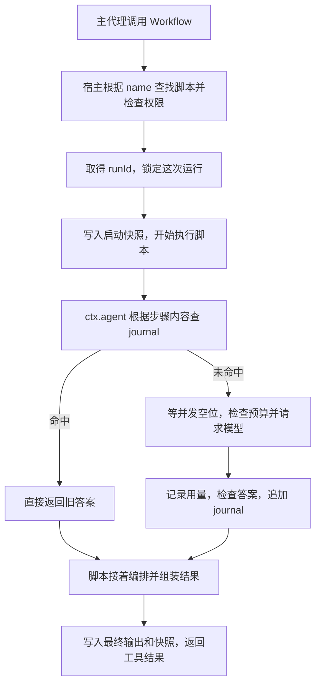

# 第 16 章 · Workflow Runtime 学习笔记

第 15 章的主代理可以读文件、问模型、看结果，再决定下一步。碰到经常重复、步骤已经确定的任务，我们可以预先写好一份 Python 脚本。第 16 章把这份脚本接到 `Workflow` 工具上。主代理选择要运行的脚本和输入，脚本安排先后顺序，每个模型步骤处理自己那一小份问题。 [原项目第 16 章中文说明](https://github.com/shareAI-lab/learn-claude-code/blob/main/s16_workflow_runtime/README.zh.md)

## 1. 从一次工具调用到一份审查结果

假设用户说「用审查工作流看看这段改动」。主代理收集改动文本后，可以发出下面的调用。

```json
{
  "name": "review-changes",
  "args": {
    "changes": "def average(scores):\n    return sum(scores) / len(scores)",
    "budget": 2000
  }
}
```

`name` 是宿主已经登记的工作流名，`args` 是脚本接收的数据，`resume_from_run_id` 是可选的旧运行编号。宿主用名字从 `WORKFLOWS` 找出 Python 函数和元数据。元数据里的 `phases` 描述这份脚本有哪些阶段，实际走到某个阶段时由脚本调用 `ctx.phase()`。 [工具参数和真实模型适配器](../agent/tools/workflow_tools.py) · [登记表、元数据和脚本](../agent/workflows.py)



内部模型调用通过 `run_agent_step()` 接口发送。每次只收到这一步所需的提示。比如复核模型会收到改动文本和一条候选问题。多个模型步骤在脚本内部把数据传给彼此，主对话收到的是一次工具返回。 [运行入口](../agent/workflow_runtime.py) · [内部模型调用](../agent/tools/workflow_tools.py)

## 2. 审查脚本到底怎么工作

当前登记了 `hello`、`topic-guide` 和 `review-changes`。可以对照这三份脚本学习。

| 脚本 | 用来理解什么 | 实际执行 |
|---|---|---|
| `hello` | `ctx.parallel()` | 解释和举例互相独立，可以一起发出，最后等两份答案 |
| `topic-guide` | `ctx.pipeline()` | 每个主题先拿解释，再用那句解释举例。多个主题各自往下走 |
| `review-changes` | 在同一份流程里组合两种做法 | 四个维度各自先审查，再并行复核本维度的候选问题 |

以 `review-changes` 为例，`correctness`（正确性）、`security`（安全性）、`performance`（性能）和 `style`（风格）同时开始。

1. 正确性分支发现 `average([])` 会除以零。它拿到候选问题后，可以立即进入复核，即使性能分支还在审查。
2. 改动中如果还有一处不必要的列表构造，性能分支也会单独复核它。一个维度有多条候选问题时，`parallel()` 会把它们并行复核。返回结果仍按传入顺序排列，所以 `zip(findings, verdicts)` 能把每条候选和对应结论配起来。
3. 所有维度结束后，脚本筛出 `isReal` 为 `true` 的问题，按严重程度排序，再返回 `confirmed`。演示里「必须写类型注解」这条候选找不到相应要求，所以复核会把它筛掉。

一条分支报错时，运行时会等已经启动的其他分支收尾，再交回错误。其他分支先完成的答案仍会写入 journal，后续能继续使用。 [三个工作流和两个并行原语](../agent/workflows.py)

## 3. 为什么答案要先检查 JSON

审查步骤需要交出一组候选问题。例如：

```json
{"findings": [{"title": "空列表会导致除零", "severity": "high"}]}
```

`validate_json()` 先看最外层是不是对象，再看其中的 `findings` 是不是数组，最后逐个检查数组里的对象。假设第一个对象把严重程度写成了数字，错误会指出 `$.findings[0].severity`。其中 `$` 表示整个答案，`[0]` 表示第一项。复核的 `isReal` 需要 JSON 布尔值 `true` 或 `false`，这样脚本才能按字段的值准确筛选。

校验失败时，`ctx.agent()` 会把错误位置加进提示并重试一次。两次都失败会给出带步骤标签的错误。通过校验的答案才能写入 journal，之后才交给下一步。续跑从 journal 再读到结构化答案时，也会按当时请求的 schema 检查。 [JSON 校验和重试](../agent/workflows.py)

## 4. 运行中看到的状态来自哪里

| 事件 | 什么时候看到 |
|---|---|
| `async_launched` | 宿主已经为这次运行建好任务记录，准备执行脚本 |
| `task_started` | 进入脚本前，带上工作流名和是否为续跑 |
| `task_progress` | 进入阶段、输出日志，或模型步骤开始、完成、命中缓存时立即显示 |
| `task_notification` | 最终输出和快照保存后，显示状态、模型用量和输出路径 |

`runId` 用来找到一次运行的文件。`taskId` 是任务事件里的标识，例如 `local_workflow_<runId>`，也出现在工具返回的 `launched` 和 `task` 里。名字为 `async_launched` 的事件会提前打印，整个工具调用在脚本完成后才返回。主循环随后可以使用完整结果继续回答用户。

宿主可以通过环境变量 `WORKFLOW_DENY` 按名称拒绝流程，多个名称用逗号隔开。这个检查在新运行、续跑和进入子工作流时都会执行。 [查找与权限检查](../agent/workflows.py) · [生命周期事件](../agent/workflow_runtime.py)

## 5. 用 runId 续跑时，程序究竟找什么

同一个编号对应下面几份文件。普通工具调用写入工作区的 `.runtime`。

| 文件 | 作用 |
|---|---|
| `<runId>.json` | 保存流程名、原始参数、任务状态、进度和本次执行用量 |
| `<runId>.output.json` | 保存最终输出，失败时保存错误 |
| `<runId>.journal.jsonl` | 每一行保存一个已经完成的步骤及其答案 |
| `<runId>.lock` | 运行期间持有文件锁，避免两个进程更新同一个编号 |

想象审查步骤已经找到除零问题，程序却在复核时退出。下一次用 `resume_from_run_id` 调用 `review-changes`，可以省略 `args`，入口会从快照读回原来的改动和预算。脚本重新从头走。走到审查步骤时，它根据标签、原始提示和 schema 算出同一个 key，于是从 journal 拿到以前那条候选问题。走到复核时，找不到旧答案的步骤才请求模型。

并行步骤谁先回来可能每次都不同。用步骤内容算 key，完成顺序变了也能找到对应的答案。这把锁覆盖读取、执行和最终保存。快照或 journal 在打开时读不出来，入口会先报告问题。 [journal 与步骤编号](../agent/workflows.py) · [读取快照与持锁过程](../agent/workflow_runtime.py)

## 6. 子流程共用什么，自己保存什么

在已登记的脚本里，可以写：

```python
brief = await ctx.workflow("hello", {"topic": "MCP"})
```

父流程等 `hello` 返回，把结果放在 `brief`。子流程有自己的当前阶段，因此它调用 `ctx.phase()` 时不会改掉父流程的阶段。它的事件仍出现在同一个任务里。journal、预算、并发空位和步骤计数都共用。子流程名也参与它的缓存 key，父子步骤即使标签和提示恰好一样，也能找到各自的旧答案。运行时支持一层嵌套。 [子流程调用](../agent/workflows.py)

## 7. 分清步骤上限、并发和预算

- **步骤上限**是每次执行最多进入 1000 次 `ctx.agent()`。读取缓存也会走这个入口。
- **并发上限**是同一时间最多 8 个模型请求。面临 JSON 重试时，重试也要等到空位。
- **用量记录**里的 `agents` 是发过模型请求的步骤数。`tokens` 累加接口响应报告的输入和输出 token，失败的答案和重试也会计入用量。全部命中 journal 的一次续跑新增用量为 0。
- **预算**来自 `args.budget`。等到并发空位后再检查有无余额，请求返回后再检查实际用量。比如预算 100，已用 70，下一条请求回来报告用了 45，程序会记下 115 并标明超额。并行时，已经发出的请求也会继续返回。 [步骤、并发和预算代码](../agent/workflows.py)

## 8. 自己跑一遍离线演示

在项目根目录打开 PowerShell，运行：

```powershell
.\.venv\Scripts\python.exe -m agent.workflow_demo demo
.\.venv\Scripts\python.exe -m agent.workflow_demo resume
```

首次运行会确认两条问题。终端显示 `agents=7`，因为四个维度各审查一次，三条候选各复核一次。演示用固定回复和模拟 token 用量，整个过程无需 API 配置。

第二次会从 `.runtime/demo/last_run.txt` 取回同一个编号，显示七条 `status=cached`，最后是 `agents=0 tokens=0`。你可以打开 `.runtime/demo/<runId>.journal.jsonl` 看看：两次运行结束后，文件仍是同样的七条答案。演示文件放在 `.runtime/demo`，普通工具调用的记录就在上一层目录。 [离线演示代码](../agent/workflow_demo.py)

回看代码时，按这个顺序打开文件就能跟完整个流程： [工具适配器](../agent/tools/workflow_tools.py) → [运行入口](../agent/workflow_runtime.py) → [审查脚本和执行上下文](../agent/workflows.py) → [离线演示](../agent/workflow_demo.py)。
