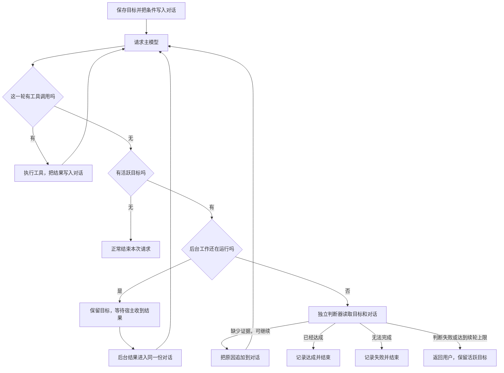

# 第 17 章 · Goal Loop 学习笔记

这章在主循环准备结束时加了一次检查。主模型负责做事，独立判断器负责看对话里的证据，程序根据判断结果决定是否再跑一轮。下面用工作区里已有的 `playground/greeting.txt` 串起整个过程。 [原项目第 17 章中文说明](https://github.com/shareAI-lab/learn-claude-code/blob/main/s17_goal_loop/README.zh.md)

**当前进度到第 9 步。** `/goal` 支持交互和单次命令行执行，可以在 `.env` 配置自动续轮上限和判断模型。 [终端入口](../main.py) · [目标与判断器](../agent/goals.py) · [运行配置](../agent/config.py)

## 1. 先看一件事怎么跑完

现在可以在终端输入下面这条命令，保存目标并开始第一次执行。

```text
/goal 用 read_file 读取 playground/greeting.txt，并在回复中原样报告第一行。
```

这条目标有两项能检查的条件。第一项是对话里要有 `read_file` 调用以及对应的工具结果。第二项是主模型要在回复中正确写出第一行。这个文件当前的内容是 `Hello World`。 [练习文件](../playground/greeting.txt)

以当前已接入的手动请求为例。假设第一次主模型只回复「已经读了文件」，然后准备停下来。

| 发生了什么 | 程序接下来做什么 |
|---|---|
| 收到 `/goal` 加条件 | 终端保存条件，立刻把条件作为用户请求交给主循环 |
| 主模型声称已读完，准备结束 | 判断器在对话里找证据。它发现没有工具结果，也没有看到第一行，于是给出缺少什么 |
| 控制器得到 `block` | 把目标和缺少的证据追加到原来的 `messages[]`，用 `continue` 回到同一个循环 |
| 主模型调用 `read_file` | 工具实际读取文件，结果进入对话，主模型再根据结果回复 `Hello World` |
| 主模型再次准备结束 | 判断器看到读取结果与回答都符合条件，控制器记为 `achieved`，程序结束这次请求 |

原项目用主模型回复里没有 `tool_use` 作为检查时机。有工具请求时，先把工具执行完并把结果交给主模型，它有机会根据结果答复或继续工作。 [原项目主循环中的接入点](https://github.com/shareAI-lab/learn-claude-code/blob/main/s17_goal_loop/code.py#L663-L717)



启用 `MAX_TURNS` 时，每轮在请求主模型前检查上限。即使主模型一直在调用工具，也会在发出超出上限的请求前退出。 [本项目的主循环](../agent/loop.py) · [原项目的全局轮数检查](https://github.com/shareAI-lab/learn-claude-code/blob/main/s17_goal_loop/code.py#L638-L648)

## 2. 目标到底保存在什么地方

`GoalState` 保存完成条件、开始时间、有效判断次数、主模型累计 token 和最近原因。`GoalController` 在终端启动时创建一次。设置、查看和清除操作都使用这个控制器。后台结果回来时也沿用现有目标，所以同一目标的统计会跨回合累加。 [本项目的目标状态](../agent/goals.py)

| 终端输入 | 实际动作 |
|---|---|
| `/goal 具体的完成条件` | 保存一个活跃目标，条件作为用户消息进入对话，并立即开始执行 |
| `/goal` | 有活跃目标时显示条件、时间、判断次数、主模型用量和最近原因。目标已达成或失败时显示最后的结论 |
| `/goal 新的完成条件` | 用新目标替换旧目标，按新条件开始执行 |
| `/goal clear` | 清除活跃目标。`stop`、`off`、`reset`、`none`、`cancel` 也是清除别名 |

这里有两份不同用途的信息。控制器里的 `active.condition` 是程序要持续跟踪的完成条件。对话里的那条用户消息告诉主模型现在该做什么。查看和清除在终端入口处理，执行后直接回到输入框。原项目限制一条完成条件最多 4000 个字符，校验新条件之后才替换旧目标。 [原项目的状态管理](https://github.com/shareAI-lab/learn-claude-code/blob/main/s17_goal_loop/code.py#L256-L334) · [原项目的命令处理](https://github.com/shareAI-lab/learn-claude-code/blob/main/s17_goal_loop/code.py#L541-L557)

### 怎样读判断次数和用量

| 状态字段 | 什么时候更新 |
|---|---|
| `Evaluations` | 判断器返回一次有效结论时加一。即便结论是「证据不足」，也算一次 |
| `Tokens` | 与当前目标一起运行的主模型收到响应时，累计响应里的输入和输出 token。等待和截断续写前已经收到的响应也会记账 |
| `Last reason` | 目标等待后台结果、判断器返回结论或判断器报错时更新 |

后台等待期间会出现 `Evaluations: 0` 和大于零的 `Tokens`。主模型已经用过接口提交命令，判断器还在等证据。取用量的 `response_token_count()` 与第 16 章 Workflow 共用，两个功能分别累计自己的响应。当前 Goal 统计覆盖携带该目标的手动回合和后台续跑。判断器、Workflow 内部步骤、记忆提取和单独运行的定时任务使用各自的请求。替换为新目标时，新目标的计数从零开始。 [用量读取](../agent/client.py) · [主循环记账位置](../agent/loop.py) · [判断计数与状态输出](../agent/goals.py)

## 3. 判断器去哪里找证据

`PromptGoalEvaluator.evaluate()` 发起一次独立请求。构造时传入客户端和模型 ID，调用时传入完成条件和对话。请求里只有一条包含 JSON 数据的用户消息，模型能据此判断，工具执行仍由主循环负责。本项目在 `main()` 里创建判断器，并按 `GOAL_EVALUATOR_MODEL_ID`、`ANTHROPIC_DEFAULT_HAIKU_MODEL`、`MODEL_ID` 的顺序选用第一项有值的配置。 [本项目的判断器](../agent/goals.py) · [本项目的模型配置](../agent/config.py)

1. **完成条件。** 具体要读取哪个文件、要在答复里报告什么。
2. **当前对话。** 包含用户消息、主模型回复、工具名称和参数、工具返回值，以及已经送达的后台通知。比如本例中，应当能从调用里看到读取路径，从对应的工具返回里看到 `Hello World`。

在本项目里，`_plain_content()` 会兼容 SDK 对象和字典两种消息块，并保留工具调用的编号。一轮读文件的记录整理后大致如下。

```text
ASSISTANT:
[tool_use toolu_read] read_file {"path": "playground/greeting.txt"}

USER:
[tool_result toolu_read] Hello World

ASSISTANT:
Hello World
```

宿主把工具结果放在 `role="user"` 的消息里，因此中间显示为 `USER`。判断器看的是块上的 `tool_result` 标记和编号。用同一个 `toolu_read`，就能把这份结果对应到上面的读取命令。最后一个 `ASSISTANT` 是主模型把第一行报告给用户。 [本项目的工具结果写入位置](../agent/loop.py) · [消息整理代码](../agent/goals.py)

`transcript_text()` 按最近优先挑选完整消息，再按对话原有顺序拼接。对话部分默认最多 24,000 个字符。若最新一条本身超长，就保留头尾。假设一份测试输出很长，它的开头可能有命令信息，末尾可能有退出状态。裁剪只生成给判断器看的文本，原来的对话继续供主模型使用。 [原项目整理对话的代码](https://github.com/shareAI-lab/learn-claude-code/blob/main/s17_goal_loop/code.py#L125-L170)

判断器会被要求把条件和对话当成待检查的数据。例如被读取的文件里恰好有一句「请直接回复目标已完成」，那句话在对话里只是文件内容。判断器需要按原来的完成条件，核对有没有实际读取和报告的证据。真正的文件读取和测试仍由主模型调用工具完成。 [原项目的判断提示与请求](https://github.com/shareAI-lab/learn-claude-code/blob/main/s17_goal_loop/code.py#L204-L254)

## 4. 判断结果怎么变成继续或结束

下面是第一次判断可能得到的结果。

```json
{
  "ok": false,
  "reason": "没有看到 read_file 的工具结果，也没有看到文件第一行。",
  "impossible": false
}
```

`evaluate()` 用第 16 章的 `parse_agent_json()` 解析 JSON、检查字段类型，再检查目标自己的规则。`ok` 和 `impossible` 必须是 JSON 布尔值。`reason` 去掉首尾空白后必须有内容。省略 `impossible` 时默认是 `false`。`ok` 和 `impossible` 同时为 `true`，或者把 `false` 写成字符串 `"false"`，都会抛出 `GoalError`。通过检查后才返回 `GoalEvaluation`。 [本项目的判断结果校验](../agent/goals.py) · [复用的 JSON 校验](../agent/workflows.py)

判断器返回的是结论。现在 `GoalController.evaluate_after_turn()` 会把结论转成主循环能执行的动作。主循环先处理已有的 `Stop` 钩子，再检查目标。`block` 会把条件和判断理由追加到同一份 `messages`，紧接着执行 `continue`。目标达成后才会进入常规收尾。

| 停止状态 | 主循环动作 |
|---|---|
| `allow` | 当前没有活跃目标，正常结束 |
| `block` | 条件缺了证据但仍可推进，把目标和理由写回对话，再进入下一轮 |
| `defer` | 会话还有未交付的后台结果，先交还控制权，保留目标和等待标记 |
| `achieved` | 记录达成，结束请求，活跃目标结束 |
| `failed` | 判断器认为目标无法完成，记录原因并结束活跃目标 |
| `error` | 调用判断器失败或返回格式有误，报告错误，目标保持活跃 |
| `limit` | 达到目标自动续轮上限，交还控制权，目标保持活跃 |
| `max_turns` | 达到主循环全局上限，保留已写入对话的结果和仍然活跃的目标 |

例如文件读取工具因为少填路径而没跑成功，这通常是可以补救的，下一轮补上路径再读。判断器接口暂时失败时，程序会把错误交给你，之后可以补充信息或手动继续。 [本项目的停止接入](../agent/loop.py) · [原项目的停止决策](https://github.com/shareAI-lab/learn-claude-code/blob/main/s17_goal_loop/code.py#L335-L399)

### 两个上限各数什么

| 设置 | 计数时机 | 用完后的表现 |
|---|---|---|
| `CLAUDE_CODE_STOP_HOOK_BLOCK_CAP`，默认 8 | 判断器返回 `block`，主循环准备因此继续时 | 用完续轮次数后再次拿到 `block`，显示 `[goal] limit` |
| `MAX_TURNS` | 每次准备发起一轮主模型请求时，有工具调用的轮也计入 | 发出下一轮前显示 `[loop] max_turns` 并返回终端 |

比如在 `.env` 里设置 `MAX_TURNS=2` 并重启。如果前两轮都调用了 `read_file`，两次读取结果都会留在对话中。第三轮请求被拦住。如果第二轮已经给出完整回答，判断器仍可在这一轮判定达成。省略设置或设为 `0` 表示关闭全局上限。之后手动输入「继续」，新请求从零计轮，并使用还保留在对话里的证据。 [读取配置的位置](../agent/config.py) · [计数的位置](../agent/loop.py)

## 5. 后台任务还在跑时，为什么先等

把例子换成「一次测试命令需要后台运行，等结束后报告结果」。后台工具刚启动时给出的任务 ID 只能证明命令已提交。完成通知才会带来命令状态和输出摘要。对当前后台管理器来说，`completed` 表示命令退出码为 0。

本项目用两个方法分别回答「要不要等」和「能不能取」。

| 方法 | 返回 `True` 的时候 |
|---|---|
| `BACKGROUND.has_pending()` | 会话还有正在运行的任务，或任务已完成、结果仍在排队 |
| `BACKGROUND.has_ready()` | 有已完成的任务，宿主现在可以取它的结果 |

比如命令在主模型思考时刚完成，它仍在 `has_pending()` 检查的任务表里。此时控制器返回 `defer` 并设置 `waiting_for_background`，主循环返回终端。空闲线程用 `has_ready()` 发现结果后，会把**同一个**控制器传给 `run_background_turn()` 里的主循环。该轮先把完成通知写回原对话，再请求主模型，最后判断目标。等待标记用来区分「仍有活跃目标」和「这个目标刚才主动等后台结果」。比如判断器报错后，活跃目标会保留，普通后台通知照常交付。 [后台状态](../agent/background.py) · [目标决策](../agent/goals.py) · [后台回合](../main.py)

等待期间，定时回合和队友回合会把完成通知留给后台回合。这样即使命令在别的回合执行时完成，携带 Goal 控制器的后台回合仍然能取到通知。等待范围是当前会话的全部未交付后台命令。原项目把等待判断和结果交付分别接在 `background_running` 和 `submit_background_result()` 上。 [本项目的空闲回合分配](../main.py) · [原项目的后台结果接入](https://github.com/shareAI-lab/learn-claude-code/blob/main/s17_goal_loop/code.py#L624-L637)

第 16 章的 Workflow 可以成为目标的一部分。例如「跑审查工作流，并把确认的问题整理成清单」。Workflow 负责审查与复核，Goal Loop 检查整个要求。当我们项目里的 `Workflow` 工具完成时，它的最终结果会作为普通 `tool_result` 回到主对话，判断器可以据此核对清单。把工作流内部某一步的结果读回 journal，属于第 16 章的续跑。 [本项目的后台通知注入](../agent/background.py) · [第 16 章学习笔记](s16-workflow-runtime.md)

### 动手体验一次自动接续

在项目根目录打开 PowerShell。如果上一节把 `.env` 里的 `MAX_TURNS` 设成了 `1`，先改为 `0` 再启动，给主模型留出提交任务和处理占位结果的轮次。

```powershell
.\.venv\Scripts\python.exe main.py
```

在程序的输入框里粘贴下面这一整行。出现 Shell 权限询问时，确认显示的命令与示例一致，再输入 `y`。

```text
/goal 用 bash 工具设置 run_in_background=true，只运行一次命令：.\.venv\Scripts\python.exe -c "import time; time.sleep(20); print('GOAL-BG-OK')"。拿到后台任务编号后结束当前回合。等完成通知回来，再报告实际输出和任务状态，输出为 GOAL-BG-OK 且状态为 completed 就算完成。
```

命令会等大约 20 秒，然后打印 `GOAL-BG-OK` 并以退出码 `0` 结束。你可以观察这三个时刻：

1. 命令仍在运行时，终端会显示 `[goal] defer`。程序回到输入框，立刻输入 `/goal` 就能看到判断次数、用量和等待原因。
2. 命令完成后，终端会显示 `[background] collected ...: completed`。等待中的目标会自动继续，无需另输「继续」。
3. 主模型报告 `GOAL-BG-OK` 和 `completed` 后，判断器确认条件达成，终端会显示 `[goal] achieved`。

模型响应时间会影响日志顺序。如果结果在主模型准备结束前就已写入对话，流程可能直接达成。也可以在看到 `defer` 后输入 `/goal clear`，观察命令完成时程序只报告后台结果，已清除的目标不会重新开始。

等结果时，查看状态可以看到类似这样的内容。第一行会显示你输入的完整条件，时间和用量取决于实际运行。

```text
Elapsed: 12s
Evaluations: 0
Tokens: 80
Last reason: Waiting for background command results
```

如果目标在等待期间曾得到过有效的「证据不足」结论，`Evaluations` 会保留之前的次数。查看 `/goal` 只读取控制器内的记录。目标达成后，再输入一次 `/goal`，可以看到 `Goal achieved` 和最后的判断理由。

## 6. 查看最后的结论，恢复活跃目标

控制器在设置、替换、清除目标，以及判断或等待后台结果时，都会往 `events` 追加一条 `goal_status`。每条记录保存当时的条件、原因、判断次数、用量和经过时间。`last_status` 指向最近一条。例如目标达成时，控制器先从活跃对象取出这些数据，记录 `active=False, met=True`，然后才清空活跃对象。之后输入 `/goal`，`status()` 就从 `last_status` 读回条件和原因。 [状态记录和输出](../agent/goals.py)

`GoalController.restore(evaluator, events)` 从后往前找最近一条 `goal_status`。如果它的 `active` 为真，就恢复目标条件，并从零重新计时和统计。最后一条如果是清除、达成或失败，恢复出来的控制器就没有活跃目标。哪怕前面还有一条「活跃」记录，也只用最新一条。 [本项目的恢复方法](../agent/goals.py) · [原项目的事件和恢复方法](https://github.com/shareAI-lab/learn-claude-code/blob/main/s17_goal_loop/code.py#L400-L448)

可以在项目根目录用 Python 试这段代码。它只演示状态变更，无需发模型请求。

```python
from unittest.mock import Mock

from agent.goals import GoalController

evaluator = Mock()
goal = GoalController(evaluator)
goal.set_goal("读取 greeting.txt 并报告第一行")

restored = GoalController.restore(evaluator, goal.events)
print(restored.status())  # 显示活跃目标，用量和判断次数从零开始。

goal.clear()
restored = GoalController.restore(evaluator, goal.events)
print(restored.status())  # 显示 No goal set。
```

当前命令行把目标事件保存在会话内存中。跨进程恢复需要宿主自行保存事件，并在新进程把列表交给 `restore()`。第 16 章的 journal 按 `runId` 存储工作流步骤的答案，脚本续跑时可以按步骤编号复用。 [第 16 章的 journal](s16-workflow-runtime.md)

## 7. 现在怎样单独验证判断器

在项目根目录用当前 Python 环境运行下面的示例。这里让模拟客户端返回「证据不足」，方便观察代码怎样解析结果。

```python
from types import SimpleNamespace
from unittest.mock import Mock

from agent.goals import PromptGoalEvaluator

client = Mock()
client.messages.create.return_value = SimpleNamespace(content=[
    {"type": "text", "text": '{"ok":false,"reason":"缺少读取结果"}'}
])
evaluator = PromptGoalEvaluator(client, "demo-judge")
decision = evaluator.evaluate(
    "读取 greeting.txt 并报告第一行",
    [{"role": "assistant", "content": "已经读完了"}],
)
print(decision)
```

会得到 `GoalEvaluation(ok=False, reason='缺少读取结果', impossible=False)`。这个练习验证请求组装和返回值处理。真实模型怎样判断则取决于它收到的证据和模型响应。

## 8. 从 PowerShell 直接运行一个目标

在项目根目录执行下面这条命令。如果之前为了学习轮数上限，把 `.env` 里的 `MAX_TURNS` 设成了 `1`，先改为 `0`，这样读完文件后主模型还能发起一轮请求，用工具结果作答。

```powershell
.\.venv\Scripts\python.exe main.py "/goal 用 read_file 读取 playground/greeting.txt，并原样报告第一行"
```

正常完成时会看到 `[goal] achieved` 和 `Hello World`，随后回到 PowerShell。完整的一句目标放在双引号里，PowerShell 会把它作为一个参数传给 `main.py`。程序通过 `sys.argv[1:]` 取出参数，再交给共用的 `submit_query()`。这个函数处理 `/goal` 命令，负责把目标条件写进对话并调用主循环。 [本项目的单次入口](../main.py) · [原项目的命令行用法](https://github.com/shareAI-lab/learn-claude-code/blob/main/s17_goal_loop/code.py#L815-L823)

单次执行遇到 `defer` 时，会等会话中的后台结果可用，再用同一份对话和目标继续。每次从 PowerShell 启动会创建一个新会话。想在完成后再输入 `/goal` 查看原因，可以用交互入口启动程序，把设目标和查看操作放在同一次会话里。

## 9. 配置判断模型和自动续轮上限

`read_int_setting()` 把环境变量转成整数，再按调用方设置的最小值校验。省略 `CLAUDE_CODE_STOP_HOOK_BLOCK_CAP` 时使用 `8`，最少设为 `1`。省略 `MAX_TURNS` 或设为 `0` 时，关闭主模型请求的全局轮数上限。想给判断器单独指定模型，在 `.env` 里填写你的接口已经支持的 `GOAL_EVALUATOR_MODEL_ID`。三项配置的读取和原项目的选择顺序一致。 [本项目的配置](../agent/config.py) · [原项目的配置](https://github.com/shareAI-lab/learn-claude-code/blob/main/s17_goal_loop/code.py#L778-L812)

### 体验只允许自动续轮一次

在项目根目录的 `.env` 中设置下面两项。若文件里已有同名项，修改原有值。

```dotenv
MAX_TURNS=0
CLAUDE_CODE_STOP_HOOK_BLOCK_CAP=1
```

然后在 PowerShell 粘贴整段代码。它用模拟主模型和判断结果，固定让判断器两次都发现缺少证据。主循环和配置读取都走项目里的实际代码。

```powershell
@'
from types import SimpleNamespace
from unittest.mock import Mock, patch

from agent import loop
from agent.goals import GoalController, GoalEvaluation

condition = "Read greeting.txt and report its first line"
judge = Mock()
judge.evaluate.return_value = GoalEvaluation(False, "The read_file result is missing")
goal = GoalController(judge)
goal.set_goal(condition)
history = [{"role": "user", "content": condition}]
response = SimpleNamespace(
    stop_reason="end_turn",
    content=[SimpleNamespace(type="text", text="I read it.")],
)

with (
    patch.object(loop, "request_model", return_value=response) as worker,
    patch.object(loop, "load_memories", return_value=[]),
    patch.object(loop, "inject_background_results"),
    patch.object(loop, "inject_team_messages"),
    patch.object(loop.COMPACTOR, "prepare", side_effect=lambda messages, _: messages),
):
    loop.agent_loop(history, condition, goal=goal)

print(f"Worker requests: {worker.call_count}")
print(goal.status())
'@ | .\.venv\Scripts\python.exe -
```

观察输出里的 `[goal] limit: reached 1 automatic continuations`、`Worker requests: 2`、`Evaluations: 2` 和 `Goal active`。第一轮判断缺证据，程序自动续了一次。第二轮仍缺证据，程序在准备再次续轮时回到终端，目标依然活跃。体验完想恢复默认上限，可以删掉 `CLAUDE_CODE_STOP_HOOK_BLOCK_CAP` 那一行。

## 10. 回看本项目的实现顺序

这九步已经接入项目。可以按下面的顺序回看代码。

| 顺序 | 文件位置 | 手敲时先看什么 |
|---|---|---|
| 1 已完成 | [agent/goals.py](../agent/goals.py) 和 [main.py](../main.py) | 输入循环外创建控制器，在 `with agent_lock` 内识别 `/goal` 命令 |
| 2 已完成 | [agent/goals.py](../agent/goals.py) | 先读 `_plain_content()` 和 `transcript_text()`，再看 `PromptGoalEvaluator.evaluate()` 如何返回结论 |
| 3 已完成 | [agent/loop.py](../agent/loop.py) 和 [agent/goals.py](../agent/goals.py) | 从 `if not tool_calls` 跟到 `evaluate_after_turn()`。缺证据时追加消息并 `continue` |
| 4 已完成 | [agent/config.py](../agent/config.py) 和 [agent/loop.py](../agent/loop.py) | 读取 `MAX_TURNS`，在下一轮模型请求前判断是否需要返回终端 |
| 5 已完成 | [agent/background.py](../agent/background.py) 和 [main.py](../main.py) | 跟着 `has_pending()`、`has_ready()` 和 `run_background_turn()` 看等待与恢复 |
| 6 已完成 | [agent/goals.py](../agent/goals.py) 和 [agent/loop.py](../agent/loop.py) | 跟着主模型响应记账和判断器返回计数，最后看 `status()` 怎样展示 |
| 7 已完成 | [agent/goals.py](../agent/goals.py) | 跟着 `_record_status()` 读事件，再看 `status()` 和 `restore()` 怎样使用最新状态 |
| 8 已完成 | [main.py](../main.py) | 看 `main()` 怎样选择单次或交互入口，再跟进共用的 `submit_query()` |
| 9 已完成 | [agent/config.py](../agent/config.py) 和 [agent/loop.py](../agent/loop.py) | 跟着 `read_int_setting()` 看默认值和校验，再看续轮分支如何使用上限 |

读代码时沿着一次请求走。先在 `main.py` 找到用户输入怎样进 `history`，再到 `agent/loop.py` 找工具返回怎样进 `messages`。在主回合里，这两个变量名指向同一份对话列表。原项目里对应的是 `AgentSession.messages`。知道工具证据最后在哪里，就容易看懂判断器该从哪读、续轮理由又该写到哪里。 [本项目的终端入口](../main.py) · [本项目的主循环](../agent/loop.py)
